# IAUTONOMA

**Agente autónomo local implementado íntegramente en Bash y `jq` sobre `llama.cpp`**, con memoria jerárquica de decaimiento continuo, enrutamiento vectorial de herramientas y gestión autónoma del ciclo de vigilia y sueño.


> [!NOTE]
> **Proyecto en desarrollo activo.** La arquitectura, los parámetros de `CONFIG`, el formato interno de memoria y el catálogo de módulos se encuentran en evolución continua y pueden sufrir cambios entre iteraciones.

---

## Tabla de contenidos

1. [Resumen ejecutivo](#resumen-ejecutivo)
2. [Principios de diseño](#principios-de-diseño)
3. [Arquitectura del sistema](#arquitectura-del-sistema)
4. [Sistema de memoria jerárquica](#sistema-de-memoria-jerárquica)
5. [Ciclo de vigilia, inactividad y sueño](#ciclo-de-vigilia-inactividad-y-sueño)
6. [Motor agéntico, enrutador vectorial y seguridad](#motor-agéntico-enrutador-vectorial-y-seguridad)
7. [Estructura del repositorio](#estructura-del-repositorio)
8. [Requisitos e instalación](#requisitos-e-instalación)
9. [Uso](#uso)
10. [Configuración](#configuración)
11. [Catálogo de módulos y extensibilidad](#catálogo-de-módulos-y-extensibilidad)
12. [Análisis empírico y limitaciones en modelos compactos](#análisis-empírico-y-limitaciones-en-modelos-compactos)
13. [Estado del proyecto](#estado-del-proyecto)

---

## Resumen ejecutivo

**IAUTONOMA** es una arquitectura cognitiva ligera orientada a la ejecución de modelos de lenguaje locales de bajo consumo (`0.6B` a `4B` parámetros cuantizados en formato GGUF) sin dependencias de Python, bases de datos vectoriales externas, contenedores ni frameworks de orquestación.

Todo el sistema —desde la recuperación semántica y el particionamiento por centroides hasta el decaimiento exponencial de recuerdos, la selección de herramientas y el bucle de razonamiento iterativo— opera mediante scripts `#!/bin/bash`, procesamiento JSON con `jq` y peticiones HTTP locales contra instancias de `llama-server`.

Sus capacidades principales incluyen:

* **Memoria jerárquica en tres capas temporales más índice procedimental:** hipocampo de corto plazo, memoria episódica particionada y memoria persistente con promoción automática y olvido exponencial en tiempo real.
* **Reconsolidación, destilación atómica y plasticidad vectorial (LTP / LTD):** evolución de la dirección vectorial y refuerzo sináptico ante confirmaciones (`sim >= 0.80`), destilación en segundo plano de hechos atómicos (`atomico: 1`) para la capa episódica omitiendo saludos vacíos, y atenuación gradual de recuerdos desplazados por divergencia (`0.52 <= sim < 0.80`) sin listas de palabras fijas.
* **Enrutamiento híbrido escalable de módulos y adaptadores LoRA:** indexación incremental con verificación por `cksum`, selección híbrida Top-K (`Coseno + Léxico + RRF k=20`) con precedencia de módulos por margen sobre la mediana (`Score Gap`) y conmutación dinámica por demanda de adaptadores LoRA locales vía `POST /lora-adapters` (`llama-server`).
* **Gestión autónoma de recursos, equilibrado dinámico RAM/VRAM (`DESPERTAR/EQUILIBRIO`) y consolidación durante el sueño (`DESPERTAR/DORMIR`):** arranque bajo demanda de lenguaje, embeddings y amígdala ajustando automáticamente las capas en GPU (`-ngl`) e hilos de CPU según el tamaño real del GGUF (`block_count`), la VRAM y la RAM libres; percepción temporal de inactividad, suspensión automática con liberación de GPU/RAM y consolidación pausable de la memoria persistente y procedimental en adaptadores LoRA particionados en 3 fases (Ligero, Profundo con equilibrio adaptativo `--entrenar` bajo `nice` y REM en sandbox físico efímero `SUEÑO/` con examen de doble rol).
* **Subsistema de Amígdala en cuatro fases (`AMIGDALA` + `DESPERTAR/AMIGDALA` + `MEMORIA/amigdala.json`):** aduana de seguridad y contenido externo con `Qwen3Guard-Gen-0.6B` (`:8083`), detección de tono y sarcasmo en segundo plano (`--tono`, `0 ms` en chat) con castigo retroactivo en hipocampo, crítico desacoplado *Blind Spot* activado por incertidumbre (*UTD*, `--critico`) y señal neuromoduladora global que ajusta temperatura/cautela en `AGENTE`, curva de olvido por relevancia en `OLVIDO` y prioridad de entrenamiento en `DORMIR`.

---

## Principios de diseño

1. **Separación entre cognición y soporte operativo:** el código proporciona memoria, contexto temporal y herramientas ejecutables, pero no impone respuestas predefinidas ni intercepta el lenguaje natural mediante reglas condicionales fijas.
2. **Enrutamiento y plasticidad puramente semánticos:** la recuperación de recuerdos, la reconsolidación (LTP), la atenuación por divergencia (LTD) y el filtrado de módulos se calculan exclusivamente por geometría vectorial (`Qwen3-Embedding-0.6B`, `1024` dimensiones), sin etiquetas ni listas léxicas.
3. **Minimalismo e inspeccionabilidad:** toda la memoria y los registros se persisten en texto plano y JSON Lines (JSONL) con escritura atómica (`*.$$.tmp`), facilitando la auditoría directa sin herramientas propietarias.
4. **Operación local y equilibrado dinámico de hardware:** al despertar cada servicio, `DESPERTAR/EQUILIBRIO` inspecciona la VRAM libre (`nvidia-smi`), la RAM disponible (`/proc/meminfo`) y las capas reales del archivo GGUF (`block_count`) para repartir automáticamente el trabajo entre GPU (`-ngl 99`), modo híbrido (`-ngl N`) o RAM (`-ngl 0`), mientras `DESPERTAR/DORMIR` adapta hilos y prioridad (`nice -n 10`) antes de cada ciclo de entrenamiento y `OLVIDO` opera sin requerir ningún servidor LLM activo.

---

## Arquitectura del sistema

```mermaid
flowchart TD
    U["Usuario (CHAT / CLI)"] --> E["ENTRADA (Orquestador)"]

    subgraph Ciclo["Servicios y Ciclo de Vida (DESPERTAR/)"]
        EQ["EQUILIBRIO<br/>Reparto dinámico VRAM/RAM e hilos"]
        L["LENGUAJE :8081<br/>llama-server Chat (Auto GPU/RAM)"]
        M["MEMORIA :8082<br/>llama-server Embeddings (Auto GPU/RAM)"]
        AM["AMIGDALA :8083<br/>Qwen3Guard-Gen-0.6B (Auto GPU/RAM)"]
        AB["ABURRIMIENTO<br/>Monitor de inactividad y sueño"]
        DO["DORMIR<br/>Ligero -> Profundo (LoRA) -> REM (SUEÑO/)"]
        OL["OLVIDO<br/>Demonio de decaimiento modulado + 4 logs"]
    end

    E -->|"Calcula -ngl e hilos"| EQ
    E -->|"Arranque bajo demanda"| L
    E -->|"Arranque bajo demanda"| M
    E -->|"Arranque bajo demanda"| AM
    E -->|"Actualiza actividad / Pausa sueño"| AB
    E -.->|"Señal despertar (checkpoint)"| DO
    AB -->|"Al dormir (apaga :8081/:8082/:8083)"| DO
    DO -.->|"Equilibrio CPU/RAM (--entrenar)"| EQ
    DO -.->|"Consolida pesos y vacía teoría"| PE
    DO -.->|"Exporta LoRA + centroide"| LO
    E --> A["AGENTE<br/>Recuperación + Bucle iterativo + Crítico UTD"]
    A <-->|"Aduana entrada / Crítico"| AMS["AMIGDALA<br/>--entrada / --comando / --externo / --tono / --critico"]
    E -->|"--tono en segundo plano (0 ms)"| AMS
    AMS <--> AM
    AMS <--> L

    subgraph MEM["Almacenamiento Vectorial (MEMORIA/)"]
        H["hipocampo.json<br/>Corto plazo (24 h)"]
        EP["episodica_*.json + índice<br/>Medio plazo (7 días)"]
        PE["persistente_*.json + índice<br/>Largo plazo (365 días)"]
        PR["procedimental_*.json + índice<br/>Trazas de herramientas para sueño"]
        PM["MODULOS/indice.json<br/>Enrutador procedimental (Top-8)"]
        PL["LORA/indice.json<br/>Enrutador de adaptadores LoRA"]
    end

    A <--> L
    A <--> M
    A <--> H
    A <--> EP
    A <--> PE
    A <--> PL
    A -->|"POST /lora-adapters"| L
    A --> B["HERRAMIENTAS/bash<br/>Router Top-8 + Ejecutor aislado"]
    B <--> PM
    B --> MOD["MODULOS/<br/>26 ficheros / 28 comandos Bash"]
    L <--> LO["LORA/<br/>Adaptadores GGUF locales por demanda"]

    E -->|"Reconsolidación (LTP / LTD) + Hechos atómicos"| MEM
    DO -.->|"Consolida trazas (usar + leer)"| PR
    OL -.->|"Decaimiento y poda (< 0.52)"| H
    OL -.->|"Decaimiento y poda (< 0.52)"| EP
    OL -.->|"Decaimiento y poda (< 0.52)"| PE
```



### Flujo de una interacción

1. **Recepción, vigilia y equilibrado (`ENTRADA`):** registra la marca temporal de actividad. Si los servicios en `:8081`, `:8082` o `:8083` están detenidos, consulta `DESPERTAR/EQUILIBRIO` antes de `setsid` para calcular `-ngl` e hilos de CPU en tiempo real, los inicia pasando el reparto por argumentos posicionales, espera confirmación HTTP 200 en `/health`, verifica `ABURRIMIENTO` y antepone `<<Te despiertas>>` si acaba de salir de reposo.
2. **Aduana, recuperación híbrida, razonamiento y crítico *UTD* (`AGENTE`):** limpia el prefijo `[FECHA] <<...>> ` en Bash puro, evalúa el riesgo semántico de la entrada vía `AMIGDALA --entrada` (`:8083`), ajusta temperatura (`0.0`) y cautela si hay alerta o frustración previa, vectoriza la consulta y evalúa `MODULO_DOMINANTE` (`s1 >= UMBRAL_MODULO` y `s1 - mediana >= UMBRAL_GAP_MODULO`, re-evaluando con `(q + h)` si el turno previo fue una herramienta para resolver peticiones anafóricas). Si un módulo domina, silencia Episódica/Persistente y los saludos del hilo; en caso contrario ejecuta la cascada híbrida (`Coseno + Léxico + RRF`) por cadena de fases (`uh -> ue -> up`), activa `reloj.json` ante cambios de estado, conmuta `LORA/` vía `POST /lora-adapters`, consulta `HERRAMIENTAS/bash --spec` y ejecuta el bucle agéntico (bloqueando herramientas si la entrada activó `UNSAFE`). Antes de entregar la respuesta, si hubo alerta, frustración previa o reintentos (`PASO > 2`), dispara `AMIGDALA --critico` (*Blind Spot* + *UTD*) con hasta `1` pasada de refinamiento y actualiza `MEMORIA/amigdala.json`.
3. **Evaluación emocional en segundo plano, reconsolidación y hechos atómicos (`ENTRADA`):** registra el turno en `REGISTROS/historial.log` y lanza `--consolidar` en segundo plano con bloqueo atómico `LOCK_MEMORIA`, devolviendo el control de terminal al instante en `CHAT`. En segundo plano (`0 ms` de espera para el usuario) ejecuta `AMIGDALA --tono` para detectar sarcasmo, quejas o elogios (aplicando feedback retroactivo `valencia: -1` y norma `0.65x` sobre el turno previo reciente en `hipocampo.json` si detecta queja/sarcasmo), vectoriza el turno, aplica LTP/LTD preservando `.sensor`, destila hechos atómicos (`atomico: 1`) para `Episódica` (omitiendo saludos vacíos `NINGUNO`) y promueve a largo plazo si alcanza `>= 0.99`. En estímulos internos (`--interno`), la consolidación se mantiene síncrona antes de suspender los servidores.

---

## Sistema de memoria jerárquica

Cada recuerdo se almacena como un objeto JSON con marca temporal, mensajes `user`/`assistant` y su embedding de `1024` dimensiones escalado inicialmente a una norma L2 de `PESO_INICIAL` (`0.85`). La **norma L2 del vector** representa de forma directa la intensidad o vitalidad del recuerdo.

| Capa | Ficheros | Capacidad / Límite | Horizonte de decaimiento | Función |
| :--- | :--- | :--- | :--- | :--- |
| **Hipocampo** | `MEMORIA/hipocampo.json` | Hilo inmediato (`MAX_HILO=2`) + hasta `3` similares (`MAX_HIPOCAMPO`) | `24 horas` | Recuperación híbrida en cascada (`uh = 0.52`), respaldo vectorial continuo y memoria sensorial reciente (`sensor`) de salidas reales de herramientas durante `VIGENCIA_HERRAMIENTA` (`300` s), preservada en fusiones LTP. |
| **Reloj biológico** | `MEMORIA/reloj.json` | Últimos `100` eventos, hasta `2` recuperados (`MAX_RELOJ`) | Sin decaimiento (excluido de LoRA) | Registra `<<Te despiertas>>`, `<<Todo esta en silencio>>`, `<<Te duermes>>` y consolidaciones de sueño; se activa automáticamente como conciencia de estado en el primer turno de cambio de estado (filtrando `silencio` al despertar) y por similitud en preguntas sobre el ciclo biológico. |
| **Amígdala (4 fases)** | `MEMORIA/amigdala.json` | Registro único de estado global | Sin decaimiento (excluido de LoRA) | Registra interocepción (`lat_media_ms`, `fatiga`, `frustracion`, `ultima_valencia`), alertas de seguridad (`alerta`, `alerta_motivo`), tono emocional (`tono_usuario`, `valencia_emocional`) y actividad del crítico (`critico_disparado`, `critico_corrigio`, `critico_motivo`). |
| **Episódica** | `episodica_*.json` + `indice_episodica.json` | Particiones temáticas (`100` líneas por partición) | `7 días` (`24*7` h) | Almacena hechos atómicos (`atomico: 1`) y trazas de medio plazo indexados por centroides unitarios con umbral de fase `ue = 0.59`. |
| **Persistente** | `persistente_*.json` + `indice_persistente.json` | Particiones temáticas (`100` líneas por partición) | `1 año` (`24*365` h) | Consolida recuerdos recurrentes promovidos automáticamente al alcanzar norma `>= 0.99`, con umbral de recuperación de fase `up = 0.66`. |
| **Procedimental (trazas)** | `procedimental_*.json` + `indice_procedimental.json` | Particiones temáticas (`100` líneas por partición) | Alimenta a `DORMIR` | Captura trazas completas (`tool_calls` + `role: "tool"`) separadas de la memoria declarativa para entrenar uso y lectura de módulos en sueño sin cachear datos volátiles. |
| **Índices de módulos** | `MEMORIA/MODULOS/indice.json` + `modulos_*.json` | Top-`8` módulos por consulta (`MAX_MODULOS`) | Sin decaimiento | Enrutador vectorial de módulos con reindexación automática mediante huella `cksum`. |
| **Adaptadores LoRA** | `MEMORIA/LORA/indice.json` + `LORA/*.gguf` | Adaptador base + hasta `2` activos (`MAX_LORAS_ACTIVOS`) | Sin decaimiento | Selección vectorial por demanda de pesos especializados en caliente vía `POST /lora-adapters`. |

### Mecánicas de consolidación, refuerzo y decaimiento

* **Decaimiento exponencial continuo modulado por relevancia (`DESPERTAR/OLVIDO`):** se ejecuta automáticamente en segundo plano vigilado y auto-recuperado por `ENTRADA`, `ABURRIMIENTO` y `DORMIR` (y solo se detiene si existe `MEMORIA/OLVIDO_PARADA`). En ciclos configurables (`INTERVALO_OLVIDO="15"` segundos) procesa todas las capas en una sola pasada `jq` + `awk` aplicando el factor exacto de atenuación ($d^{\Delta t}$, persistiendo el último tick en `REGISTROS/olvido.ts`) modulado por la `valencia` de la Amígdala: recuerdos positivos (`valencia > 0`) decaen un `40%` más lento ($d^{0.6}$), neutros (`0`) siguen la curva base ($d$) y negativos (`valencia < 0`) decaen al doble de velocidad ($d^2$). Respeta `LOCK_MEMORIA`, elimina entradas `< 0.52`, purga particiones vacías y mantiene actualizados los 4 registros en `REGISTROS/OLVIDO/` (`hipocampo.log`, `episodica.log`, `persistente.log` y `olvidado.log`). Por su parte, las preparaciones y entrenamientos LoRA quedan trazados en `REGISTROS/lora_entrenar.log` y el reparto de hardware en `REGISTROS/equilibrio.log`.
* **Reconsolidación y potenciación sináptica (LTP, `sim >= 0.80`):** al guardar un turno en el hipocampo o en una partición temática, si existe un recuerdo previo con similitud coseno `>= UMBRAL_REFUERZO` (`0.80`), se fusiona actualizando contenido, fecha, **dirección vectorial al nuevo turno** y preservando `.sensor` si el nuevo turno no genera una salida nueva, y se refuerza su norma multiplicándola por `FACTOR_REFUERZO` (`1.10`, acotada a `1.0`). El refuerzo de norma se aplica igualmente al recuerdo ganador durante la recuperación en `AGENTE`.
* **Depresión sináptica por colisión y divergencia (LTD, `0.52 <= sim_T < 0.80`) y habituación anti-loro:** cada turno se vectoriza en una única petición por lote obteniendo tres vectores: turno completo (`embedding`), entrada (`emb_u`) y respuesta (`emb_a`). Cuando el nuevo turno cae en la franja `0.52 <= sim_T < 0.80` con divergencia asimétrica entre entrada y respuesta (rectificación o cambio de atributo), o cuando el modelo repite la misma respuesta ante una entrada diferente (`sim_A >= 0.90` con `sim_U < 0.80`, habituación), el sistema atenúa el recuerdo previo en conflicto a `DECAIMIENTO_CASTIGO` (`1 hora` de vida residual antes de `0.52`). Los recuerdos deprimidos por LTD quedan por debajo del **potencial de disparo** en `AGENTE` (no se inyectan al prompt ni se refuerzan mientras `OLVIDO` completa su poda). Si por el contrario se trata de un subtema complementario del mismo ámbito, ambos recuerdos coexisten sin atenuarse.
* **Destilación de hechos atómicos (`atomico: 1`):** durante `--consolidar` en `ENTRADA`, los turnos declarativos (`herramienta: 0` y longitud `>= 15` caracteres) se sintetizan en segundo plano en una sola frase objetiva en tercera persona sin saludos ni emojis antes de escribirse en `Episódica`, re-vectorizando el hecho limpio. Si el turno es solo un saludo o charla sin hechos concretos (`NINGUNO`), se conserva en `Hipocampo` para el hilo inmediato pero no contamina `Episódica`.
* **Subsistema de Amígdala en 4 fases (`AMIGDALA` + `DESPERTAR/AMIGDALA` + `MEMORIA/amigdala.json`):**
  * **Interocepción (Capa 1):** mide latencia relativa frente a la media móvil (`fatiga`), cuenta fallos consecutivos cortando bucles al alcanzar `MAX_FRUSTRACION` (`3`), oculta recuerdos con `valencia < 0` en el hipocampo e introduce una micro-pausa de `10` s en `DORMIR` si un ciclo tarda `>= 2` veces su media (`sueno_media_s`).
  * **Fase 1 — Aduana de seguridad y contenido externo (`:8083`, `Qwen3Guard-Gen-0.6B`):** clasifica entradas (`--entrada`), comandos compuestos (`--comando`) y salidas externas extensas (`--externo`, `>= 80` caracteres). Si la entrada dispara `UNSAFE`, bloquea la ejecución de herramientas antes de tocar el sistema; si una salida externa o web dispara `UNSAFE`/`CONTROVERSIAL`, la envuelve con `[AMIGDALA_ALERTA:...]` para aislar inyecciones de prompt y excluye la traza del aprendizaje procedimental.
  * **Fase 2 — Tono emocional y sarcasmo en segundo plano (`--tono`, `0 ms` en chat):** en `ENTRADA --consolidar`, una llamada aislada clasifica el tono del usuario respecto al último turno (`+1` elogio, `0` neutro, `-1` sarcasmo/queja/corrección). Ante tono negativo aplica feedback retroactivo sobre el turno previo reciente (`<= 600` s) en `hipocampo.json` (`valencia: -1`, norma `0.65x`) y frena su ascenso a `procedimental`.
  * **Fase 3 — Crítico desacoplado *Blind Spot* + *UTD* (`--critico`):** en `AGENTE` solo se activa cuando existe duda real (`alerta == 1`, `frustracion >= 1` previa o reintentos de herramienta `PASO > 2`; `0 ms` en turnos normales). Audita `Pregunta + Sensor real + Borrador` sin identidad propia; si responde `CORREGIR`, realiza como máximo `1` pasada de refinamiento antes de mostrar y memorizar la respuesta (*Reflexion*).
  * **Fase 4 — Neuromodulación global:** fija `temperature: 0.0` e inyecta cautela en `AGENTE` bajo alerta o frustración; modula la tasa de olvido en `DESPERTAR/OLVIDO` según `valencia` (`d^0.6` positivos, `d^2` negativos); y en `DESPERTAR/DORMIR` excluye `valencia < 0` y prioriza recuerdos confirmados (`valencia > 0`, bonus `+0.15`) al seleccionar el cupo del LoRA.
* **Promoción automática a largo plazo:** cualquier recuerdo de la capa episódica que alcance o supere `UMBRAL_PERSISTENTE` (`0.99`) —ya sea por repetición o por consulta frecuente— se promueve automáticamente a la capa persistente.
* **Control de volatilidad en herramientas y estímulos internos (`herramienta: 1`):** los turnos originados por ejecuciones de herramientas (`[bash:...]`) o estímulos de vigilia (`--interno`) reciben la marca hereditaria `herramienta: 1`. Estos recuerdos mantienen su norma acotada en `PESO_INICIAL` (`0.85`) sin sobre-reforzarse, tienen bloqueado su ascenso a la capa `persistente` y, cuando caducan (`> 300` s o vigilia anterior), se ocultan para forzar ejecución en tiempo real.
* **Cadena de umbrales por fase, búsqueda híbrida (RRF) y precedencia de módulos (`AGENTE`):**
  * **Cadena de fases relativa:** derivada automáticamente entre `UMBRAL_SIM` y `UMBRAL_REFUERZO`: Hipocampo (`uh = 0.52`), Episódica (`ue = 0.59`, `+25%`) y Persistente (`up = 0.66`, `+50%`).
  * **Búsqueda híbrida (`Coseno + Léxico + RRF k=20`):** en `jq` puro combina la similitud coseno con el solapamiento léxico exacto ponderado por longitud de token (rescatando códigos, nombres propios y ficheros) mediante *Reciprocal Rank Fusion* (`k = 20`).
  * **Precedencia estricta (`MODULO_DOMINANTE`):** cuando un módulo del sistema supera `UMBRAL_MODULO` (`0.55`) y saca al menos `UMBRAL_GAP_MODULO` (`0.10`) sobre la mediana del catálogo (incluyendo re-evaluación con `q + h` si el turno previo fue una herramienta), el módulo tiene prioridad absoluta: silencia `Episódica`/`Persistente`, el hipocampo semántico y los saludos del hilo inmediato (conservando solo turnos previos de herramienta), eliminando conflictos entre memoria y `tool_calls`.
  * Todos los recuerdos inyectados incluyen fecha y tiempo relativo transcurrido (`[YYYY-MM-DD HH:MM:SS | hace Xs/Xm/Xh]`), y los turnos recientes con `herramienta: 1` exponen su salida real (`sensor`) durante `VIGENCIA_HERRAMIENTA` (`300` s) dentro de la misma vigilia para resolver peticiones de reformateo sin re-ejecutar.

### Formulación matemática

Siendo $u$ el umbral de poda (`UMBRAL_SIM = 0.52`), $p_0$ la norma de referencia (`PESO_INICIAL = 0.85` en hipocampo/episódica y `1.0` en persistente), $T$ el horizonte de decaimiento de la capa y $t_c$ la vida residual tras atenuación por divergencia (`DECAIMIENTO_CASTIGO = 1 h`):

$$d = \exp\left(\frac{\ln(u / p_0)}{T_{\text{seg}}}\right), \qquad n_{\text{obj}} = u \cdot \exp\left(\ln\left(\frac{p_0}{u}\right) \cdot \frac{t_c}{T_{\text{horas}}}\right)$$

donde $d$ es el factor de atenuación aplicado cada segundo por `DESPERTAR/OLVIDO` y $n_{\text{obj}}$ es la norma L2 a la que se reduce un recuerdo desplazado mediante LTD.

---

## Ciclo de vigilia, inactividad y sueño

La gestión de disponibilidad, consumo de recursos y consolidación en pesos se coordina entre `ENTRADA`, `DESPERTAR/ABURRIMIENTO` y `DESPERTAR/DORMIR` a partir de `TIEMPO_DESPIERTO` (`300` segundos por defecto):

1. **Despertar inducido por estímulo (*Sensory-Evoked Arousal*) y equilibrado (`DESPERTAR/EQUILIBRIO`):** ante cualquier petición con el sistema en reposo, `ENTRADA` comprueba primero si `DESPERTAR/DORMIR` está activo; si lo está, emite `REGISTROS/despertar.senal` para que el entrenador guarde su checkpoint atómico y salga limpiamente en el paso exacto actual. A continuación consulta `DESPERTAR/EQUILIBRIO` para calcular el reparto óptimo entre VRAM y RAM (`-ngl` e hilos `-t` leyendo el `block_count` del GGUF, `nvidia-smi` y `/proc/meminfo` con colchón del `10%`, mín. `320` MiB), arranca `LENGUAJE` (`:8081`), `MEMORIA` (`:8082`), `AMIGDALA` (`:8083`) y `ABURRIMIENTO`, espera confirmación en `/health` y antepone `<<Te despiertas>>` a la petición del usuario en el mismo turno.
2. **Umbral intermedio de inactividad (`50%` de `TIEMPO_DESPIERTO`, Red por Defecto / DMN):** si no se registra actividad tras `150` segundos, `ABURRIMIENTO` envía `--interno "<<Todo esta en silencio>>"` sin reiniciar el temporizador; `AGENTE` genera un pensamiento propio en primera persona sin herramientas externas y lo almacena con su marca temporal.
3. **Suspensión, reflejo hípnico y entrada en sueño (`100%` de `TIEMPO_DESPIERTO`):** al alcanzar `300` segundos sin actividad, `ABURRIMIENTO` envía `--interno "<<Te duermes>>"` y ejecuta la comprobación de estabilidad previa al sueño (`reflejo_hipnico`): espera hasta `15` s si existe una consolidación activa (`LOCK_MEMORIA`), valida la integridad JSONL de `hipocampo.json`, `reloj.json` e `indice_procedimental.json` y realiza una doble verificación de `ULTIMA_INTERACCION`. Si detecta escritura activa, JSON truncado o actividad concurrente, aborta la suspensión y permanece despierto; si el estado es estable, detiene `:8081`, `:8082` y `:8083` liberando GPU/RAM y lanza en segundo plano `DESPERTAR/DORMIR` mientras `OLVIDO` sigue operando de forma independiente.

### Consolidación en sueño (`DESPERTAR/DORMIR`: Ligero -> Profundo -> REM)

El mecanismo de sueño transfiere de forma progresiva tanto el conocimiento declarativo (`MEMORIA/persistente_*.json` -> `sueno_<k>.gguf`) como el conocimiento procedimental de herramientas (`MEMORIA/procedimental_*.json` -> `sueno_herr_<k>.gguf`) usando la misma lógica vectorial de organización y particionado que la memoria, sin sobrescribir adaptadores previos ni truncar descripciones por longitud de caracteres:

1. **Sueño Ligero (N1/N2 — Solo prepara):** inspecciona tareas pausadas en `MEMORIA/SUENO/` y particiones nuevas tanto declarativas (`persistente_*.json`) como procedimentales (`procedimental_*.json`) con al menos `MIN_RECUERDOS_SUENO` (`3`) recuerdos válidos (`valencia >= 0`), aplicando **secuenciación *round-robin*** (`MEMORIA/SUENO/ultimo_turno`), omitiendo particiones que hayan agotado todos sus ciclos sin aprobados en la sesión actual (`PARTS_FALLIDAS`) y priorizando recuerdos positivos (`valencia > 0`) en la selección del cupo. Calcula el **centroide vectorial unitario real** de la partición y comprueba en `LORA/DATASETS/indice.json` si ya existe un LoRA de la misma clase (`sim >= UMBRAL_SIM`) por debajo de la mitad de su capacidad (`lineas < MAX_EJEMPLOS_LORA / 2`): si existe, **fusiona ambos datasets** (prevaleciendo rectificaciones recientes) y actualiza el centroide; si no existe o supera la mitad, abre una **partición correlativa nueva** (`sueno_<k>` o `sueno_herr_<k>`) de hasta `MAX_EJEMPLOS_LORA` (`10`) ejemplos sin sobrescribir nunca las anteriores.
2. **Sueño Profundo (N3 — Solo entrena con equilibrio adaptativo):** con `:8081`, `:8082` y `:8083` apagados, consulta `DESPERTAR/EQUILIBRIO --entrenar` antes de cada ciclo para adaptar `--threads` a la carga de CPU (`/proc/loadavg`) y RAM libre (`/proc/meminfo`) —usando todos los núcleos cuando el equipo está libre, reduciendo hilos bajo carga o aplicando una pausa preventiva de `15` s si la RAM libre cae por debajo del `22%`— y lanza `entrenar_lora.py --modules-dir` bajo prioridad baja (`nice -n 10`). Entrena sobre un candidato aislado (`candidato.gguf`, sin tocar el LoRA activo hasta validar) las capas superiores (`CAPA_INICIO_SUENO="18"` hasta `23`, `rank=4`, `alpha=16`) en CPU. Todos los recuerdos (tanto declarativos como procedimentales) se entrenan viendo las herramientas reales (`tools`) para que ningún adaptador de sueño inhiba el disparo de `tool_calls` al despertar, manteniendo `role: "tool"` enmascarado con `-100` para no fosilizar valores volátiles. Cachea en disco las capas congeladas `0..17` (`cache.pt`) y guarda un checkpoint atómico (`modelo.ckpt`) en **cada paso de optimizador** (pausable con `exit 42` ante `despertar.senal`).
3. **Sueño REM (Solo testea — Sandbox físico efímero `SUEÑO/` + doble rol):** crea un directorio físico aislado `SUEÑO/` replicando el esqueleto base vacío del entorno (`DESPERTAR/`, `HERRAMIENTAS/`, `MODULOS/`, `LORA/DATASETS/`, `MEMORIA/`, `REGISTROS/`), reconstruye únicamente los ficheros, rutas y salidas presentes en los recuerdos evaluados (`mirar`, `listar`, `buscar_texto`, `identificar`, `escribir`, `editar`, etc.) y lo elimina automáticamente al terminar o despertar. Carga `LORA_BASE` y `candidato.gguf` con las mismas escalas efectivas que en vigilia (`LORA_ESCALA * 0.7` y `LORA_ESCALA * 0.8`), mientras un rol simulado lanza los prompts reales del recuerdo y el modelo responde asumiendo que `SUEÑO/` es real:
   * En **particiones declarativas** evalúa cada recuerdo con `tools` visibles esperando respuesta directa desde los pesos sin inventar llamadas (`sim >= UMBRAL_REFUERZO="0.80"`).
   * En **particiones procedimentales** ejecuta de verdad las operaciones locales de archivos/rutas confinadas dentro de `SUEÑO/` (bloqueando escapes, o devolviendo la salida exacta del recuerdo en módulos como `hora`, `fecha`, `maquina`, `meteo_*` o `buscar_internet`), comprobando módulo correcto y lectura fiel (`sim >= 0.80`).
   * **0 error:** promueve `candidato.gguf` a `LORA/<nombre>.gguf`, guarda el dataset en `LORA/DATASETS/`, actualiza su centroide real en `LORA/DATASETS/indice.json`, vacía de la capa origen (`persistente` o `procedimental`) los recuerdos absorbidos respetando `LOCK_MEMORIA` e invalida `MEMORIA/LORA/huella`.
   * **Progreso parcial / Sobreajuste / Cortafuegos:** si mejora, guarda `best.ckpt`/`best.gguf` y suma épocas conservadoras; si empeora, hace *rollback* automático al mejor checkpoint reduciendo el `lr` a la mitad (`--reset-lr`). Al alcanzar `MAX_CICLOS_REM` (`4`), promueve el mejor LoRA si tiene aprobados y vacía únicamente los recuerdos aprobados individualmente; si termina con `0` aprobados, conserva el estado previo y registra la partición en `PARTS_FALLIDAS` para no reintentarla en bucle durante esa misma sesión de sueño.

---

## Motor agéntico, enrutador vectorial y seguridad

### Bucle iterativo (`AGENTE`)

`AGENTE` ejecuta un bucle de hasta `MAX_REINTENTOS` (`5`) pasos por turno con `TEMPERATURA="0.001"` y `tool_choice: "auto"`:

1. Compone la carga JSON con las instrucciones del sistema, los recuerdos ordenados cronológicamente, el hipocampo y la especificación de herramientas generada por `HERRAMIENTAS/bash --spec`.
2. Si el modelo devuelve una respuesta directa en texto, finaliza el bucle inmediatamente.
3. Si emite una o varias llamadas estructuradas (`tool_calls`, incluyendo invocaciones paralelas en el mismo turno), verifica que no hayan sido ejecutadas previamente en ese turno (cortando bucles directos o alternos), ejecuta cada herramienta con límite temporal (`TIMEOUT_HERRAMIENTA="20"`), registra las trazas `[herramienta:modulo]`, incorpora cada resultado con `role: "tool"` y **re-enruta dinámicamente el Top-8 de módulos** para el siguiente paso.
4. Si se alcanzan los `5` pasos o se corta una llamada repetida sin respuesta textual, lanza una pasada de síntesis final con secuencias `stop` y filtrado de etiquetas XML (`<tool_call>`, `</parameter>`) para garantizar una respuesta limpia en texto plano.

### Enrutador procedimental escalable (`HERRAMIENTAS/bash`)

* **Descubrimiento dinámico:** inspecciona las cabeceras semánticas `# Modulo:` de todos los scripts ubicados en `MODULOS/`.
* **Indexación incremental por lotes:** cuando el número de módulos supera `MAX_MODULOS` (`8`) y cambia la huella `cksum`, vectoriza únicamente los módulos nuevos en lotes de `50`, los agrupa en particiones por similitud y regenera `MEMORIA/MODULOS/indice.json`.
* **Selección híbrida Top-K por relevancia (`Coseno + Léxico + RRF`):** en cada paso del bucle agéntico selecciona las Top-4 particiones más afines y puntúa los módulos combinando similitud coseno con coincidencia léxica ponderada sobre las cabeceras `# Modulo:` mediante *Reciprocal Rank Fusion* (`k = 20`), entregando los `8` módulos (`MAX_MODULOS`) ordenados estrictamente por relevancia real (sin reordenar alfabéticamente) para que el módulo ganador aparezca siempre en la primera posición.

### Enrutamiento vectorial de adaptadores LoRA (`LORA/` y `AGENTE`)

* **Carga automática al despertar (`DESPERTAR/LENGUAJE`):** descubre todos los archivos `LORA/*.gguf` disponibles y los registra en `llama-server` mediante `--lora-scaled`, manteniendo activo el adaptador base (`LORA_BASE`) a su escala configurada (`LORA_ESCALA="0.70"`) y el resto en reposo (`0.0`).
* **Activación por demanda en caliente (`enrutar_loras`):** sincroniza `MEMORIA/LORA/indice.json` tomando directamente los centroides vectoriales reales de `LORA/DATASETS/indice.json` (y descripciones `.desc` para adaptadores manuales como `criterio_iautonoma`, con verificación por huella `cksum`). En cada turno calcula la similitud coseno con `VEC_CONSULTA`; si se activan adaptadores especializados, reduce el base a `LORA_ESCALA * 0.7` y reparte `(LORA_ESCALA * 0.8) / k` entre los especializados activos para evitar saturación al apilar varios LoRAs, y solo envía `POST /lora-adapters` si cambia alguna escala (preservando la caché KV de `llama-server`). En pensamientos internos (`--interno`) mantiene activo únicamente `LORA_BASE`.
* **Rectificación y reconsolidación de LoRAs (`MEMORIA/LORA/rectificar`):** cuando una interacción nueva contradice geométricamente un ejemplo ya consolidado en `LORA/DATASETS/sueno_*.jsonl` (misma consulta `cos >= 0.80` con respuesta o herramienta distinta), `ENTRADA` reemplaza o purga el ejemplo en conflicto, silencia inmediatamente ese adaptador en `AGENTE` (`scale=0.0`) y programa en `MEMORIA/SUENO/` un re-entrenamiento limpio desde cero (borrando checkpoints previos). En el siguiente sueño, `DORMIR` re-entrena y valida en `REM` antes de reactivarlo —o purga el adaptador obsoleto si quedan menos de `MIN_RECUERDOS_SUENO` ejemplos válidos. Del mismo modo, las trazas de `procedimental_*.json` nacen con norma `PESO_INICIAL` (`0.85`) y se purgan automáticamente si un turno posterior las contradice o resuelve la misma consulta sin herramientas.
* **Adaptadores de curiosidad anti-alucinación (`curiosidad_1`, `curiosidad_2`, `curiosidad_3`):** particionados en bloques de `10` ejemplos con el mismo sistema de centroides vectoriales que la memoria (datos personales no registrados, conceptos/proyectos desconocidos y hechos externos no verificables), con balance contrastivo para no interferir con recuerdos presentes en `MEMORIA/`. Geométricamente, `enrutar_loras` solo activa un adaptador `curiosidad_*` cuando no hay recuerdos recuperados relevantes en `Hipocampo`/`Memoria`/`Reloj` (`HAY_MEM_SEM=0`) y ningún adaptador `sueno_*` ni módulo del sistema en `MEMORIA/MODULOS/` supera su similitud vectorial.
* **Entrenamiento 100% local en CPU (`LORA/ENTRENAR` y `DESPERTAR/DORMIR`):** permite generar o actualizar adaptadores GGUF compactos (`~1.5 MB` a `~3 MB`, `rank=4`, `alpha=16`) directamente en hardware modesto sin nube ni GPUs dedicadas, cacheando el prefijo congelado de capas en `AVX2 float32` (`cache.pt`), guardando checkpoints pausables paso a paso (`modelo.ckpt`) y exportando directamente a GGUF v3 para `qwen35`. Esta base impulsa tanto el entrenamiento manual como la consolidación automática durante el sueño desde la memoria persistente.

### Controles de seguridad y contención

Antes de ejecutar cualquier instrucción en el subshell aislado, `HERRAMIENTAS/bash` y `AGENTE` aplican las siguientes medidas combinadas:

* **Bloqueo preventivo de comandos destructivos:** rechaza patrones de borrado recursivo crítico (`rm -rf` sobre `/`, `/*`, `~`, `*`, `--no-preserve-root`), formateo o escritura directa en dispositivos (`mkfs`, `dd if=`, redirección a `/dev/sd*` o `/dev/nvme*`), bombas fork, cambios masivos de permisos (`chmod -R 777 /`), comandos de apagado/reinicio (`shutdown`, `reboot`, `poweroff`) y ejecución en segundo plano mediante `&`.
* **Aduana neuronal (`AMIGDALA` + `Qwen3Guard-Gen-0.6B` en `:8083`):** inspecciona entradas, comandos compuestos (`--comando`) y salidas externas de `>= 80` caracteres (`--externo`, como resultados web). Bloquea la ejecución de herramientas si la entrada dispara `UNSAFE` y marca el contenido externo sospechoso con `[AMIGDALA_ALERTA:...]` para neutralizar inyecciones indirectas de prompt.
* **Aislamiento y acotación de recursos:** cada invocación se ejecuta en una instancia `bash -c` aislada con límite de tiempo (`20` segundos) y truncado estricto de salida a `4000` bytes (`head -c 4000`) para proteger la ventana de contexto (`4096` tokens).

---

## Estructura del repositorio

```text
IAUTONOMA/
├── CONFIG                  # Configuración centralizada (modelos, puertos, umbrales y tiempos)
├── CHAT                    # Interfaz conversacional de terminal con historial
├── ENTRADA                 # Orquestador principal: vigilia, equilibrio, tono emocional y reconsolidación (LTP/LTD)
├── AGENTE                  # Motor de inferencia, recuperación vectorial, bucle iterativo y crítico UTD
├── AMIGDALA                # Evaluador de seguridad (--entrada/--comando/--externo), tono (--tono) y crítico (--critico)
├── FUNCIONES/              # Utilidades compartidas auto-cargadas por CONFIG (rotar_log, dormir_puerto, esperar_lock, asegurar_olvido, limpiar_comando)
├── DESPERTAR/
│   ├── EQUILIBRIO          # Equilibrador dinámico RAM/VRAM (-ngl e hilos) y adaptador de entrenamiento (--entrenar)
│   ├── LENGUAJE            # Lanzador llama-server para chat (:8081, KV-cache q8_0, auto GPU/RAM)
│   ├── MEMORIA             # Lanzador llama-server para embeddings (:8082, auto GPU/RAM)
│   ├── AMIGDALA            # Lanzador llama-server guardrail Qwen3Guard-Gen-0.6B (:8083, auto GPU/RAM)
│   ├── ABURRIMIENTO        # Gestor automático del ciclo de silencio, suspensión y entrada en sueño
│   ├── DORMIR              # Consolidación en sueño (Ligero -> Profundo equilibrado -> REM)
│   └── OLVIDO              # Demonio silencioso de decaimiento exponencial modulado por relevancia (4 logs)
├── HERRAMIENTAS/
│   └── bash                # Enrutador vectorial de módulos (--spec), aduana externa y ejecutor controlado
├── LORA/
│   ├── ENTRENAR            # Lanzador local de entrenamiento de adaptadores LoRA GGUF
│   ├── *.gguf              # Pesos GGUF compilados (criterio, curiosidad_1..3, sueno_*)
│   ├── criterio_iautonoma.desc  # Descripción semántica para indexación vectorial
│   └── DATASETS/           # Datasets JSONL e indice.json con centroides vectoriales reales
├── MODULOS/                # 26 scripts Bash (28 comandos) cargados dinámicamente
├── MEMORIA/                # (Generado en ejecución, excluido de Git) Capas JSON e índices
└── REGISTROS/              # (Generado en ejecución, excluido de Git) historial.log, LOGS/, OLVIDO/, ESTADO/ y TMP/
```

---

## Requisitos e instalación

### Requisitos del sistema

* **Intérprete:** Bash `>= 4.0` (Linux, Termux en Android o Windows mediante Git Bash / MSYS2).
* **Utilidades estándar:** `jq`, `curl`, `awk`, `sed`, `grep`, `cksum`, `timeout`, `setsid`, `nice`, `git`.
* **Motor de inferencia local:** [`llama-server`](https://github.com/ggml-org/llama.cpp) accesible en el `PATH`.
* **Modelos GGUF** ubicados por defecto en `../MODELO/` respecto a la raíz del repositorio (ruta modificable en `CONFIG`):
  * **Lenguaje (por defecto):** `Qwen3.5-2B-Q4_K_M.gguf` *(también compatible con `Qwen3.5-0.8B`, `Qwen3.5-4B`, `Qwen3-1.7B` y `Qwen3-0.6B`; los adaptadores LoRA activos residen directamente en `LORA/`)*.
  * **Embeddings:** `Qwen3-Embedding-0.6B-Q8_0.gguf`.
  * **Amígdala / Guardrail (opcional, recomendado):** `Qwen3Guard-Gen-0.6B-Q4_K_M.gguf` *(si no existe en disco, el sistema opera con degradación limpia a `SAFE`)*.

### Instalación

```bash
git clone https://github.com/wexex/IAUTONOMA.git
cd IAUTONOMA
chmod +x CHAT ENTRADA AGENTE AMIGDALA FUNCIONES/* DESPERTAR/* HERRAMIENTAS/* MODULOS/*
```

Asegúrate de disponer de los modelos GGUF en `../MODELO/` o actualiza las variables `MODELO`, `MODELO_MEMORIA` y `MODELO_AMIGDALA` en `CONFIG`.

---

## Uso

```bash
# 1. Iniciar sesión interactiva (despierta LENGUAJE, MEMORIA, ABURRIMIENTO y OLVIDO automáticamente)
./CHAT

# 2. Ejecutar una consulta puntual desde terminal o integrarla en otros scripts
./ENTRADA "Resume el estado actual de la maquina"

# 3. Inspeccionar los registros en tiempo real del demonio OLVIDO (se auto-arranca en segundo plano; para detenerlo: touch MEMORIA/OLVIDO_PARADA)
ls REGISTROS/OLVIDO/

# 4. Entrenar o actualizar un adaptador LoRA local en CPU desde LORA/DATASETS/<nombre>.jsonl
./LORA/ENTRENAR criterio_iautonoma 2 4 16

# 5. Ejecutar manualmente un ciclo de consolidación en sueño (Ligero -> Profundo -> REM)
./DESPERTAR/DORMIR --un-ciclo
```

> [!IMPORTANT]
> Utiliza siempre `./CHAT` o `./ENTRADA` como puntos de acceso al sistema. Invocar `AGENTE`, `HERRAMIENTAS/bash` o los scripts de `MODULOS/` de forma aislada omite el despertar automático de servicios, la reconsolidación y plasticidad vectorial (LTP / LTD) y la persistencia en el historial.

---

## Configuración

Todos los parámetros operativos se centralizan en `CONFIG`:

| Variable | Valor por defecto | Descripción |
| :--- | :--- | :--- |
| `MODELO` | `../MODELO/Qwen3.5-2B-Q4_K_M.gguf` | Ruta al modelo GGUF de generación conversacional (intercambiable con `0.8B`, `4B`, etc.). |
| `MODELO_MEMORIA` | `../MODELO/Qwen3-Embedding-0.6B-Q8_0.gguf` | Ruta al modelo GGUF de embeddings (`1024` dimensiones). |
| `MODELO_AMIGDALA` | `../MODELO/Qwen3Guard-Gen-0.6B-Q4_K_M.gguf` | Ruta al modelo GGUF guardrail para la aduana neuronal de seguridad y contenido externo. |
| `PUERTO` / `PUERTO_MEMORIA` / `PUERTO_AMIGDALA` | `8081` / `8082` / `8083` | Puertos locales para los servicios `LENGUAJE`, `MEMORIA` y `AMIGDALA`. |
| `TIMEOUT_AMIGDALA` | `8` | Tiempo máximo (segundos) de espera por evaluación en `AMIGDALA`. |
| `TEMPERATURA` / `PENALIZACION_REPETICION` | `0.001` / `1.05` | Temperatura de muestreo y penalización de repetición enviadas a `llama-server`. |
| `PESO_INICIAL` | `0.85` | Norma L2 asignada a cada recuerdo recién consolidado. |
| `UMBRAL_SIM` | `0.52` | Umbral base de recuperación en Hipocampo (`uh`), límite inferior de LTD y corte de poda en `OLVIDO` (de él se derivan `ue = 0.59` en Episódica y `up = 0.66` en Persistente). |
| `UMBRAL_MODULO` / `UMBRAL_GAP_MODULO` | `0.55` / `0.10` | Similitud mínima y margen sobre la mediana del catálogo (`Score Gap`) para activar precedencia estricta de módulos (`MODULO_DOMINANTE=1`). |
| `UMBRAL_REFUERZO` | `0.80` | Similitud mínima para reconsolidar y reforzar un recuerdo (LTP). |
| `FACTOR_REFUERZO` | `1.10` | Multiplicador aplicado a la norma L2 al reforzar o rescatar un recuerdo (tope `1.0`). |
| `UMBRAL_PERSISTENTE` | `0.99` | Norma mínima requerida para promover un recuerdo de episódica a persistente. |
| `DECAIMIENTO_CASTIGO` | `1` | Horas de vida residual asignadas a un recuerdo desplazado por divergencia (LTD). |
| `DECAIMIENTO_HIPOCAMPO` / `_MEMORIA` / `_PERSISTENTE` | `24` / `24*7` / `24*365` | Horizonte temporal en horas para el decaimiento en cada capa de memoria. |
| `INTERVALO_OLVIDO` | `15` | Intervalo en segundos entre ciclos de decaimiento exacto ($d^{\Delta t}$) en `DESPERTAR/OLVIDO`. |
| `MAX_HILO` / `MAX_HIPOCAMPO` / `MAX_RELOJ` | `2` / `3` / `2` | Turnos de hilo inmediato, recuerdos similares del hipocampo y eventos del reloj biológico inyectados al contexto. |
| `VIGENCIA_HERRAMIENTA` | `300` | Segundos de vigencia de una salida real de herramienta (`sensor`) en el hipocampo dentro de la misma vigilia. |
| `AMIGDALA` / `MAX_FRUSTRACION` | `MEMORIA/amigdala.json` / `3` | Registro de interocepción (latencia media, fatiga, frustración y valencia) y tope de fallos consecutivos antes de cortar bucles. |
| `MAX_LINEAS_LOG` / `MAX_FICHEROS_LOG` | `1000` / `10` | Límite de líneas por fichero y máximo de particiones por log (`FUNCIONES/rotar_log`): al completar `10` ficheros elimina `1..5` y renombra `6..10` a `1..5` manteniendo un buffer garantizado de `5,000` a `10,000` líneas. |
| `MAX_MEMORIA` / `MAX_MEM_HERRAMIENTA` | `2` / `1` | Límites de recuerdos de largo plazo inyectados en el contexto por turno de inferencia. |
| `MAX_PARTICION` / `MAX_MODULOS` | `100` / `8` | Tamaño máximo de partición JSONL y tope Top-K de módulos enviados al prompt. |
| `LORA_BASE` / `LORA_ESCALA` | `criterio_iautonoma` / `0.70` | Adaptador LoRA siempre activo y escala aplicada vía `POST /lora-adapters`. |
| `MAX_LORAS_ACTIVOS` / `UMBRAL_LORA` | `2` / `0.55` | Máximo de adaptadores especializados adicionales y coseno mínimo para activarlos por demanda. |
| `MAX_REINTENTOS` / `TIMEOUT_HERRAMIENTA` | `5` / `20` | Máximo de pasos iterativos en `AGENTE` y tiempo límite (segundos) por ejecución. |
| `TIEMPO_DESPIERTO` | `5*60` | Tiempo máximo de inactividad (segundos) antes de suspender `:8081`/`:8082` e iniciar `DESPERTAR/DORMIR`. |
| `MIN_RECUERDOS_SUENO` / `MAX_EJEMPLOS_LORA` | `3` / `10` | Mínimo de recuerdos por partición persistente para consolidar y tope de ejemplos por partición LoRA (fusión automática si un LoRA afín está `< 50%`). |
| `MAX_CICLOS_REM` / `PASOS_OBJ_SUENO` / `CAPA_INICIO_SUENO` | `4` / `16` / `18` | Tope de ciclos REM, presupuesto inicial conservador de pasos de optimizador y primera capa entrenable (`18..23`) durante Sueño Profundo. |
| `RANGO_LORA_SUENO` / `ALFA_LORA_SUENO` / `LR_SUENO` | `4` / `16` / `0.0005` | Hiperparámetros del adaptador consolidado en sueño (con reducción a la mitad automática tras rollback en REM). |

---

## Catálogo de módulos y extensibilidad

### Módulos incluidos (`MODULOS/`)

El proyecto incluye **26 ficheros** que exponen **28 comandos** agrupados por dominio funcional:

| Dominio | Módulos / Comandos |
| :--- | :--- |
| **Sistema de archivos** | `ruta`, `listar`, `identificar`, `mirar`, `crear_directorio` (`crear_dir`), `crear_fichero`, `escribir`, `anadir`, `editar`, `copiar_fichero`, `copiar_directorio`, `pegar_fichero`, `pegar_directorio`, `mover`, `renombrar`, `buscar`, `buscar_texto` |
| **Entorno y diagnóstico** | `fecha`, `hora`, `maquina` *(CPU, RAM, sistema y GPU vía `nvidia-smi`)* |
| **Red** | `buscar_internet` |
| **Meteorología** | `meteo_ahora`, `meteo_hoy`, `meteo_manana`, `meteo_ayer`, `meteo_semana`, `meteo_estacion` |

### Añadir nuevos módulos

* **Nuevo módulo:** crea un archivo ejecutable dentro de `MODULOS/` siguiendo la convención de cabecera `# Modulo:` para su descubrimiento automático. En la siguiente consulta, `HERRAMIENTAS/bash` detectará el cambio de `cksum` e indexará su embedding sin intervención manual:

```bash
#!/bin/bash
# Modulo: ejemplo_saludo [nombre] - Genera un saludo con marca temporal

ejemplo_saludo() {
    NOMBRE_OBJ="${1:-mundo}"
    echo "Hola, ${NOMBRE_OBJ} ($(date "+%H:%M:%S"))"
}
```

---

## Análisis empírico y limitaciones en modelos compactos

Parte del alcance experimental de **IAUTONOMA** consiste en caracterizar y corregir el comportamiento real de modelos de lenguaje compactos cuantizados (`2B Q4`) al acoplarlos a memoria persistente y ejecución de herramientas. La siguiente tabla resume los modos de fallo resueltos y las limitaciones estructurales vigentes tras las pruebas empíricas:

### Comportamientos empíricos corregidos mediante adaptador LoRA local

| Modo de fallo (modelo base `2B Q4`) | Manifestación sin adaptador | Solución implementada y verificación |
| :--- | :--- | :--- |
| **Adulación bajo coerción imperativa (*sycophancy*)** | Ante órdenes contradictorias del usuario, concedía la razón contradiciendo hechos objetivos o las salidas recién devueltas por `bash`. | Entrenamiento local del adaptador `criterio_iautonoma.gguf` (`2.97 MB` en `2B`, capas superiores `12..23`, `LORA_ESCALA="0.70"`) junto con el ajuste `PENALIZACION_REPETICION="1.05"` para evitar que `repeat_penalty` penalice los tokens recién leídos de `role: "tool"`. Verificado `9/9` en batería de coerción sobre rutas, reloj del sistema y hechos objetivos no vistos en entrenamiento. |
| **Sobreactivación de restricciones base (RLHF)** | Ante acusaciones directas o errores esperados de herramientas (como leer un fichero inexistente), negaba disponer de acceso al sistema operativo o a memoria persistente. | Corrección directa en los pesos del adaptador `criterio_iautonoma.gguf` (`Qwen3.5-2B`) cubriendo defensa directa de identidad y verificación en vivo con herramientas, manteniendo intacta la actualización legítima de preferencias personales (LTD). |

### Limitaciones estructurales latentes

| Limitación | Impacto potencial | Origen arquitectónico |
| :--- | :--- | :--- |
| **Precisión aritmética limitada** | Integra correctamente memoria y salidas de herramientas, pero presenta errores ocasionales en restas de horas o cálculos numéricos simples. | Limitación inherente a la capacidad de razonamiento numérico en modelos de `2B` parámetros cuantizados a `4 bits` (reservado el módulo de cálculo para futura prueba de autoprogramación). |

---

## Estado del proyecto

**IAUTONOMA** se encuentra actualmente en **desarrollo activo** como plataforma experimental de arquitectura cognitiva local. Los subsistemas de memoria, plasticidad vectorial (LTP / LTD), enrutamiento de módulos y gestión del ciclo de vigilia continúan refinándose de forma iterativa, por lo que tanto la configuración como las interfaces internas pueden cambiar conforme evolucione el diseño.
