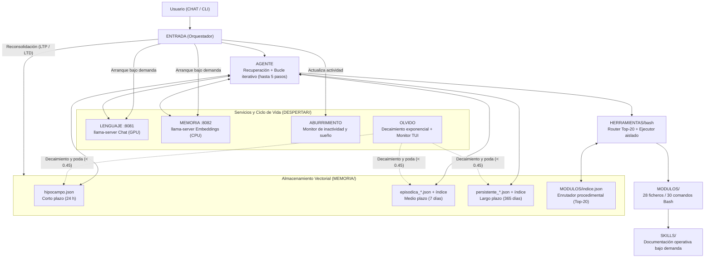

# IAUTONOMA

**Agente autónomo local implementado íntegramente en Bash y `jq` sobre `llama.cpp`**, con memoria jerárquica de decaimiento continuo, enrutamiento vectorial de herramientas y gestión autónoma del ciclo de vigilia y sueño.


> [!NOTE]
> **Proyecto en desarrollo activo.** La arquitectura, los parámetros de `CONFIG`, el formato interno de memoria y el catálogo de módulos se encuentran en evolución continua y pueden sufrir cambios entre iteraciones.

---

## Tabla de contenidos

1. [Resumen ejecutivo](#resumen-ejecutivo)
2. [Principios de diseño](#principios-de-diseño)
3. [Arquitectura del sistema](#arquitectura-del-sistema)
4. [Sistema de memoria jerárquica](#sistema-de-memoria-jerárquica)
5. [Ciclo de vigilia, inactividad y sueño](#ciclo-de-vigilia-inactividad-y-sueño)
6. [Motor agéntico, enrutador vectorial y seguridad](#motor-agéntico-enrutador-vectorial-y-seguridad)
7. [Estructura del repositorio](#estructura-del-repositorio)
8. [Requisitos e instalación](#requisitos-e-instalación)
9. [Uso](#uso)
10. [Configuración](#configuración)
11. [Catálogo de módulos y extensibilidad](#catálogo-de-módulos-y-extensibilidad)
12. [Análisis empírico y limitaciones en modelos compactos](#análisis-empírico-y-limitaciones-en-modelos-compactos)
13. [Estado del proyecto](#estado-del-proyecto)

---

## Resumen ejecutivo

**IAUTONOMA** es una arquitectura cognitiva ligera orientada a la ejecución de modelos de lenguaje locales de bajo consumo (`0.6B` a `4B` parámetros cuantizados en formato GGUF) sin dependencias de Python, bases de datos vectoriales externas, contenedores ni frameworks de orquestación.

Todo el sistema —desde la recuperación semántica y el particionamiento por centroides hasta el decaimiento exponencial de recuerdos, la selección de herramientas y el bucle de razonamiento iterativo— opera mediante scripts `#!/bin/bash`, procesamiento JSON con `jq` y peticiones HTTP locales contra instancias de `llama-server`.

Sus capacidades principales incluyen:

* **Memoria jerárquica en tres capas temporales más índice procedimental:** hipocampo de corto plazo, memoria episódica particionada y memoria persistente con promoción automática y olvido exponencial en tiempo real.
* **Reconsolidación y plasticidad vectorial (LTP / LTD):** evolución de la dirección vectorial y refuerzo sináptico ante confirmaciones (`sim >= 0.80`), junto con atenuación gradual de recuerdos desplazados por divergencia (`0.45 <= sim < 0.80`) sin listas de palabras fijas.
* **Enrutamiento vectorial escalable de módulos:** indexación incremental con verificación por `cksum` y selección Top-K para escalar el catálogo de herramientas sin saturar la ventana de contexto.
* **Gestión autónoma de recursos:** arranque bajo demanda de los servidores de lenguaje y embeddings, percepción temporal de inactividad y suspensión automática con liberación de memoria GPU/RAM.

---

## Principios de diseño

1. **Separación entre cognición y soporte operativo:** el código proporciona memoria, contexto temporal y herramientas ejecutables, pero no impone respuestas predefinidas ni intercepta el lenguaje natural mediante reglas condicionales fijas.
2. **Enrutamiento y plasticidad puramente semánticos:** la recuperación de recuerdos, la reconsolidación (LTP), la atenuación por divergencia (LTD) y el filtrado de módulos se calculan exclusivamente por geometría vectorial (`Qwen3-Embedding-0.6B`, `1024` dimensiones), sin etiquetas ni listas léxicas.
3. **Minimalismo e inspeccionabilidad:** toda la memoria y los registros se persisten en texto plano y JSON Lines (JSONL) con escritura atómica (`*.$$.tmp`), facilitando la auditoría directa sin herramientas propietarias.
4. **Operación local y eficiencia de hardware:** el modelo de lenguaje corre acelerado en GPU con caché KV cuantizada (`q8_0`) y Flash Attention, mientras que el modelo de embeddings corre en CPU (`-ngl 0`) para no competir por VRAM, y el proceso de olvido opera sin requerir ningún servidor LLM activo.

---

## Arquitectura del sistema



### Flujo de una interacción

1. **Recepción y vigilia (`ENTRADA`):** registra la marca temporal de actividad. Si los servicios en `:8081` o `:8082` están detenidos, los inicia en segundo plano con `setsid`, espera confirmación HTTP 200 en `/health`, verifica `ABURRIMIENTO` y envía el estímulo interno `<<Te despiertas>>` antes de atender la consulta.
2. **Recuperación y razonamiento (`AGENTE`):** vectoriza la consulta (anclándola al último turno del hipocampo si tiene menos de `25` caracteres), recupera recuerdos relevantes, solicita a `HERRAMIENTAS/bash --spec` los módulos más afines (con `skill` garantizado) y ejecuta el bucle agéntico contra `LENGUAJE`.
3. **Reconsolidación, plasticidad (LTP / LTD) y registro (`ENTRADA`):** vectoriza el par interacción-respuesta con fecha exacta (`YYYY-MM-DD HH:MM:SS`), aplica reconsolidación con refuerzo (`>= 0.80`) o atenuación por divergencia (`0.45..0.80`) en hipocampo, episódica y persistente, promueve a largo plazo si alcanza `>= 0.99` y anexa el turno en `REGISTROS/historial.log`.

---

## Sistema de memoria jerárquica

Cada recuerdo se almacena como un objeto JSON con marca temporal, mensajes `user`/`assistant` y su embedding de `1024` dimensiones escalado inicialmente a una norma L2 de `PESO_INICIAL` (`0.85`). La **norma L2 del vector** representa de forma directa la intensidad o vitalidad del recuerdo.

| Capa | Ficheros | Capacidad / Límite | Horizonte de decaimiento | Función |
| :--- | :--- | :--- | :--- | :--- |
| **Hipocampo** | `MEMORIA/hipocampo.json` | Últimos `2` turnos activos (`MAX_HIPOCAMPO`) | `24 horas` | Preserva el contexto inmediato y ancla entradas breves (`< 25` caracteres). |
| **Episódica** | `episodica_*.json` + `indice_episodica.json` | Particiones temáticas (`100` líneas por partición) | `7 días` (`24*7` h) | Almacena recuerdos de medio plazo indexados por centroides unitarios (búsqueda Top-2). |
| **Persistente** | `persistente_*.json` + `indice_persistente.json` | Particiones temáticas (`100` líneas por partición) | `1 año` (`24*365` h) | Consolida recuerdos recurrentes promovidos automáticamente al alcanzar norma `>= 0.99`. |
| **Procedimental** | `MEMORIA/MODULOS/indice.json` + `modulos_*.json` | Top-`20` módulos por consulta (`MAX_MODULOS`) | Sin decaimiento | Enrutador vectorial de módulos con reindexación automática mediante huella `cksum`. |

### Mecánicas de consolidación, refuerzo y decaimiento

* **Decaimiento exponencial continuo (`DESPERTAR/OLVIDO`):** cada segundo multiplica las componentes de cada vector por su factor de atenuación y elimina toda entrada cuya norma L2 caiga por debajo de `UMBRAL_SIM` (`0.45`). Cuando una partición queda vacía, `OLVIDO` elimina el archivo del disco y purga su referencia en el índice. Incluye un monitor de terminal en tiempo real con barras de vitalidad por capa y registro de elementos purgados.
* **Reconsolidación y potenciación sináptica (LTP, `sim >= 0.80`):** al guardar un turno en el hipocampo o en una partición temática, si existe un recuerdo previo con similitud coseno `>= UMBRAL_REFUERZO` (`0.80`), se fusiona actualizando contenido, fecha y **dirección vectorial al nuevo turno**, y se refuerza su norma multiplicándola por `FACTOR_REFUERZO` (`1.10`, acotada a `1.0`). El refuerzo de norma se aplica igualmente al recuerdo ganador durante la recuperación en `AGENTE`.
* **Depresión sináptica por colisión y divergencia (LTD, `0.45 <= sim < 0.80`):** cuando el nuevo turno (entrada del usuario más respuesta del modelo) cae dentro del mismo dominio temático que un recuerdo previo (`>= 0.45`) pero diverge en su dirección semántica (`< 0.80`) por una corrección o cambio de estado, el sistema atenúa el recuerdo previo más cercano en conflicto a la norma exacta equivalente a `DECAIMIENTO_CASTIGO` (`1 hora` de vida residual antes de `0.45`) en hipocampo, episódica y persistente, e inserta el nuevo turno actualizado con peso limpio (`0.85`).
* **Promoción automática a largo plazo:** cualquier recuerdo de la capa episódica que alcance o supere `UMBRAL_PERSISTENTE` (`0.99`) —ya sea por repetición o por consulta frecuente— se promueve automáticamente a la capa persistente.
* **Equilibrio en la recuperación (`AGENTE`):** las consultas recuperan hasta `MAX_MEMORIA` (`2`) recuerdos adicionales al hipocampo, limitando a `MAX_MEM_HERRAMIENTA` (`1`) el número de recuerdos procedentes de salidas previas de herramientas para evitar la saturación del contexto con datos volátiles. Todos los recuerdos inyectados incluyen el prefijo `[YYYY-MM-DD HH:MM:SS]`.

### Formulación matemática

Siendo $u$ el umbral de poda (`UMBRAL_SIM = 0.45`), $p_0$ la norma de referencia (`PESO_INICIAL = 0.85` en hipocampo/episódica y `1.0` en persistente), $T$ el horizonte de decaimiento de la capa y $t_c$ la vida residual tras atenuación por divergencia (`DECAIMIENTO_CASTIGO = 1 h`):

$$d = \exp\left(\frac{\ln(u / p_0)}{T_{\text{seg}}}\right), \qquad n_{\text{obj}} = u \cdot \exp\left(\ln\left(\frac{p_0}{u}\right) \cdot \frac{t_c}{T_{\text{horas}}}\right)$$

donde $d$ es el factor de atenuación aplicado cada segundo por `DESPERTAR/OLVIDO` y $n_{\text{obj}}$ es la norma L2 a la que se reduce un recuerdo desplazado mediante LTD.

---

## Ciclo de vigilia, inactividad y sueño

La gestión de disponibilidad y consumo de recursos se coordina entre `ENTRADA` y `DESPERTAR/ABURRIMIENTO` a partir de `TIEMPO_DESPIERTO` (`300` segundos por defecto):

1. **Despertar bajo demanda:** ante cualquier petición con el sistema en reposo, `ENTRADA` arranca `LENGUAJE` (`:8081`), `MEMORIA` (`:8082`) y `ABURRIMIENTO`, espera a que ambos endpoints `/health` respondan y procesa el estímulo interno `<<Te despiertas>>` antes del turno del usuario.
2. **Umbral intermedio de inactividad (`50%` de `TIEMPO_DESPIERTO`):** si no se registra actividad tras `150` segundos, `ABURRIMIENTO` envía `--interno "<<Todo esta en silencio>>"` sin reiniciar el temporizador de vigilia.
3. **Suspensión (`100%` de `TIEMPO_DESPIERTO`):** al alcanzar `300` segundos sin actividad, `ABURRIMIENTO` envía `--interno "<<Te duermes>>"`, verifica que no haya habido una interacción concurrente durante el procesamiento y detiene únicamente los procesos de los puertos `8081` y `8082` (usando `taskkill`/`netstat` en Windows o `fuser` en Linux), manteniendo `OLVIDO` en ejecución independiente.

---

## Motor agéntico, enrutador vectorial y seguridad

### Bucle iterativo (`AGENTE`)

`AGENTE` ejecuta un bucle de hasta `MAX_REINTENTOS` (`5`) pasos por turno con `TEMPERATURA="0.001"` y `tool_choice: "auto"`:

1. Compone la carga JSON con las instrucciones del sistema, los recuerdos ordenados cronológicamente, el hipocampo y la especificación de herramientas generada por `HERRAMIENTAS/bash --spec`.
2. Si el modelo devuelve una respuesta directa en texto, finaliza el bucle inmediatamente.
3. Si emite una llamada estructurada (`tool_calls`), ejecuta la herramienta con límite temporal (`TIMEOUT_HERRAMIENTA="20"`), registra la traza `[herramienta:modulo]`, incorpora el resultado con `role: "tool"` y **re-enruta dinámicamente el Top-20 de módulos** para el siguiente paso combinando la consulta con el módulo y la salida obtenidos.
4. Si se alcanzan los `5` pasos sin emitir una respuesta textual, lanza una pasada de síntesis final sin campo `tools` para elaborar la respuesta definitiva con los datos obtenidos.

### Enrutador procedimental escalable (`HERRAMIENTAS/bash`)

* **Descubrimiento dinámico:** inspecciona las cabeceras semánticas `# Modulo:` de todos los scripts ubicados en `MODULOS/`.
* **Indexación incremental por lotes:** cuando el número de módulos supera `MAX_MODULOS` (`20`) y cambia la huella `cksum`, vectoriza únicamente los módulos nuevos en lotes de `50`, los agrupa en particiones por similitud y regenera `MEMORIA/MODULOS/indice.json`.
* **Selección Top-K adaptativa y anclaje de `skill`:** en cada paso del bucle agéntico selecciona las Top-4 particiones más afines, filtra los `20` módulos de mayor similitud y garantiza siempre la presencia de `skill` (el cual permite consultar tanto `SKILLS/` como el listado completo de `MODULOS/`).

### Controles de seguridad y contención

Antes de ejecutar cualquier instrucción en el subshell aislado, `HERRAMIENTAS/bash` aplica las siguientes medidas:

* **Bloqueo preventivo de comandos destructivos:** rechaza patrones de borrado recursivo crítico (`rm -rf` sobre `/`, `/*`, `~`, `*`, `--no-preserve-root`), formateo o escritura directa en dispositivos (`mkfs`, `dd if=`, redirección a `/dev/sd*` o `/dev/nvme*`), bombas fork, cambios masivos de permisos (`chmod -R 777 /`), comandos de apagado/reinicio (`shutdown`, `reboot`, `poweroff`) y ejecución en segundo plano mediante `&`.
* **Aislamiento y acotación de recursos:** cada invocación se ejecuta en una instancia `bash -c` aislada con límite de tiempo (`20` segundos) y truncado estricto de salida a `4000` bytes (`head -c 4000`) para proteger la ventana de contexto (`4096` tokens).

---

## Estructura del repositorio

```text
IAUTONOMA/
├── CONFIG                  # Configuración centralizada (modelos, puertos, umbrales y tiempos)
├── CHAT                    # Interfaz conversacional de terminal con historial
├── ENTRADA                 # Orquestador principal: vigilia, reconsolidación (LTP/LTD) y logs
├── AGENTE                  # Motor de inferencia, recuperación vectorial y bucle iterativo
├── DESPERTAR/
│   ├── LENGUAJE            # Lanzador llama-server para chat (:8081, GPU, KV-cache q8_0)
│   ├── MEMORIA             # Lanzador llama-server para embeddings (:8082, CPU)
│   ├── ABURRIMIENTO        # Gestor automático del ciclo de silencio y suspensión
│   └── OLVIDO              # Demonio de decaimiento exponencial continuo y monitor TUI
├── HERRAMIENTAS/
│   └── bash                # Enrutador vectorial de módulos (--spec) y ejecutor controlado
├── MODULOS/                # 28 scripts Bash (30 comandos) cargados dinámicamente
├── SKILLS/
│   └── tareas_bash.txt     # Guías operativas consultables bajo demanda mediante el módulo skill
├── MEMORIA/                # (Generado en ejecución, excluido de Git) Capas JSON e índices
└── REGISTROS/              # (Generado en ejecución, excluido de Git) Logs y estado de vigilia
```

---

## Requisitos e instalación

### Requisitos del sistema

* **Intérprete:** Bash `>= 4.0` (Linux, Termux en Android o Windows mediante Git Bash / MSYS2).
* **Utilidades estándar:** `jq`, `curl`, `awk`, `sed`, `grep`, `cksum`, `timeout`, `setsid`, `git`.
* **Motor de inferencia local:** [`llama-server`](https://github.com/ggml-org/llama.cpp) accesible en el `PATH`.
* **Modelos GGUF** ubicados por defecto en `../MODELO/` respecto a la raíz del repositorio (ruta modificable en `CONFIG`):
  * **Lenguaje (por defecto):** `Qwen3.5-2B-Q4_K_M.gguf` *(también validado con variantes `Qwen3.5-4B`, `Qwen3-1.7B`, `Qwen3.5-0.8B` y `Qwen3-0.6B`)*.
  * **Embeddings:** `Qwen3-Embedding-0.6B-Q8_0.gguf`.

### Instalación

```bash
git clone https://github.com/wexex/IAUTONOMA.git
cd IAUTONOMA
chmod +x CHAT ENTRADA AGENTE DESPERTAR/* HERRAMIENTAS/* MODULOS/*
```

Asegúrate de disponer de los modelos GGUF en `../MODELO/` o actualiza las variables `MODELO` y `MODELO_MEMORIA` en `CONFIG`.

---

## Uso

```bash
# 1. Iniciar sesión interactiva (despierta LENGUAJE, MEMORIA y ABURRIMIENTO al primer mensaje)
./CHAT

# 2. Ejecutar una consulta puntual desde terminal o integrarla en otros scripts
./ENTRADA "Resume el estado actual de la maquina"

# 3. Iniciar el proceso de olvido continuo y su monitor en tiempo real (terminal independiente)
./DESPERTAR/OLVIDO
```

> [!IMPORTANT]
> Utiliza siempre `./CHAT` o `./ENTRADA` como puntos de acceso al sistema. Invocar `AGENTE`, `HERRAMIENTAS/bash` o los scripts de `MODULOS/` de forma aislada omite el despertar automático de servicios, la reconsolidación y plasticidad vectorial (LTP / LTD) y la persistencia en el historial.

---

## Configuración

Todos los parámetros operativos se centralizan en `CONFIG`:

| Variable | Valor por defecto | Descripción |
| :--- | :--- | :--- |
| `MODELO` | `../MODELO/Qwen3.5-2B-Q4_K_M.gguf` | Ruta al modelo GGUF de generación conversacional. |
| `MODELO_MEMORIA` | `../MODELO/Qwen3-Embedding-0.6B-Q8_0.gguf` | Ruta al modelo GGUF de embeddings (`1024` dimensiones). |
| `PUERTO` / `PUERTO_MEMORIA` | `8081` / `8082` | Puertos locales para los servicios `LENGUAJE` y `MEMORIA`. |
| `TEMPERATURA` | `0.001` | Temperatura de muestreo para máxima reproducibilidad en llamadas a herramientas. |
| `PESO_INICIAL` | `0.85` | Norma L2 asignada a cada recuerdo recién consolidado. |
| `UMBRAL_SIM` | `0.45` | Umbral mínimo de similitud de recuperación, límite inferior de LTD y corte de poda en `OLVIDO`. |
| `UMBRAL_REFUERZO` | `0.80` | Similitud mínima para reconsolidar y reforzar un recuerdo (LTP). |
| `FACTOR_REFUERZO` | `1.10` | Multiplicador aplicado a la norma L2 al reforzar o rescatar un recuerdo (tope `1.0`). |
| `UMBRAL_PERSISTENTE` | `0.99` | Norma mínima requerida para promover un recuerdo de episódica a persistente. |
| `DECAIMIENTO_CASTIGO` | `1` | Horas de vida residual asignadas a un recuerdo desplazado por divergencia (LTD). |
| `DECAIMIENTO_HIPOCAMPO` / `_MEMORIA` / `_PERSISTENTE` | `24` / `24*7` / `24*365` | Horizonte temporal en horas para el decaimiento en cada capa de memoria. |
| `MAX_HIPOCAMPO` / `MAX_MEMORIA` / `MAX_MEM_HERRAMIENTA` | `2` / `2` / `1` | Límites de turnos inyectados en el contexto por turno de inferencia. |
| `MAX_PARTICION` / `MAX_MODULOS` | `100` / `20` | Tamaño máximo de partición JSONL y tope Top-K de módulos enviados al prompt. |
| `MAX_REINTENTOS` / `TIMEOUT_HERRAMIENTA` | `5` / `20` | Máximo de pasos iterativos en `AGENTE` y tiempo límite (segundos) por ejecución. |
| `TIEMPO_DESPIERTO` | `5*60` | Tiempo máximo de inactividad (segundos) antes de suspender `:8081` y `:8082`. |

---

## Catálogo de módulos y extensibilidad

### Módulos incluidos (`MODULOS/`)

El proyecto incluye **28 ficheros** que exponen **30 comandos** agrupados por dominio funcional:

| Dominio | Módulos / Comandos |
| :--- | :--- |
| **Sistema de archivos** | `ruta`, `listar`, `identificar`, `mirar`, `crear_directorio` (`crear_dir`), `crear_fichero`, `escribir`, `anadir`, `editar`, `copiar_fichero`, `copiar_directorio`, `pegar_fichero`, `pegar_directorio`, `mover`, `renombrar`, `buscar`, `buscar_texto` |
| **Entorno y diagnóstico** | `fecha`, `hora`, `maquina` *(CPU, RAM, sistema y GPU vía `nvidia-smi`)* |
| **Red y control de versiones** | `buscar_internet`, `subir_github` |
| **Meteorología** | `meteo_ahora`, `meteo_hoy`, `meteo_manana`, `meteo_ayer`, `meteo_semana`, `meteo_estacion` |
| **Guías operativas** | `skill` *(sin argumentos lista las guías disponibles en `SKILLS/`)* |

### Añadir nuevos módulos y guías

* **Nuevo módulo:** crea un archivo ejecutable dentro de `MODULOS/` siguiendo la convención de cabecera `# Modulo:` para su descubrimiento automático. En la siguiente consulta, `HERRAMIENTAS/bash` detectará el cambio de `cksum` e indexará su embedding sin intervención manual:

```bash
#!/bin/bash
# Modulo: ejemplo_saludo [nombre] - Genera un saludo con marca temporal

ejemplo_saludo() {
    NOMBRE_OBJ="${1:-mundo}"
    echo "Hola, ${NOMBRE_OBJ} ($(date "+%H:%M:%S"))"
}
```

* **Nueva skill:** añade un fichero `.txt` o `.md` dentro de `SKILLS/`. Quedará accesible de inmediato a través del comando `skill <nombre>`.

---

## Análisis empírico y limitaciones en modelos compactos

Parte del alcance experimental de **IAUTONOMA** consiste en caracterizar el comportamiento real de modelos de lenguaje compactos cuantizados (`2B Q4`) al acoplarlos a memoria persistente y ejecución de herramientas. La siguiente tabla resume los modos de fallo observados y las limitaciones estructurales identificadas durante las pruebas:

### Comportamientos empíricos observados

| Modo de fallo | Manifestación observable | Causa técnica |
| :--- | :--- | :--- |
| **Sesgo de repetición y anclaje negativo** | Reitera literalmente respuestas previas o reproduce un dato incorrecto tras leer una negación que lo menciona. | La combinación de un modelo `2B Q4` con `TEMPERATURA="0.001"` favorece la copia literal del contexto inmediato; los mecanismos de atención se fijan en el valor citado incluso bajo negación explícita. |
| **Atenuación de contexto por umbral o ventana** | Pierde continuidad ante consultas ambiguas o sobre hechos antiguos no reforzados. | El LLM carece de estado interno: si un recuerdo decae bajo `0.45`, sale de las cuotas `MAX_HIPOCAMPO`/`MAX_MEMORIA` o no alcanza similitud suficiente en la búsqueda vectorial, queda excluido del prompt. |
| **Persistencia de datos volátiles** | Responde con horas, rutas o lecturas meteorológicas históricas como si fueran actuales sin invocar herramientas. | Datos efímeros repetidos o consultados con frecuencia pueden superar `0.99` y promoverse a `persistente`; pese al prefijo temporal `[YYYY-MM-DD HH:MM:SS]`, los modelos `2B` tienden a confundir el recuerdo reforzado con el estado presente. |
| **Alucinación de ejecución de herramientas** | Declara haber ejecutado un módulo o fabrica una salida ficticia sin emitir una llamada estructurada `tool_calls`. | Bajo restricciones de capacidad, el modelo simula la acción en lenguaje natural en lugar de activar el protocolo estructurado de invocación. |
| **Ambigüedad pronominal en estímulos internos** | Ante `<<Te despiertas>>` o `<<Te duermes>>`, responde como si el sujeto que realiza la acción fuera el usuario. | Los estímulos internos ingresan con `role: "user"`, provocando que el modelo interprete la segunda persona como conversación dirigida a un interlocutor humano. |
| **Adulación tras corrección (*sycophancy*)** | Ante una crítica o corrección, concede la razón de forma indiscriminada llegando a contradecir hechos o su propia identidad operativa. | El ajuste conversacional base de los modelos compactos prioriza el acuerdo con el usuario sobre la consistencia fáctica cuando detecta desacuerdo. |
| **Confusión entre esquema de herramientas y `SKILLS/`** | Enumera los módulos visibles en `tools` denominándolos *skills* en lugar de invocar `bash: skill`. | Interpreta el listado de firmas de módulos inyectado en el esquema de funciones como si correspondiera al contenido del directorio `SKILLS/`. |
| **Sobreactivación de restricciones base (RLHF)** | Afirma no disponer de acceso al sistema operativo o a memoria persistente pese a tener ambos activos. | Ante errores de ejecución o cuestionamientos del usuario, los reflejos conservadores del alineamiento de fábrica prevalecen sobre las instrucciones del `system` prompt. |
| **Bucles de generación en etiquetas de invocación** | Emite etiquetas parciales repetitivas (`<tool_call>`, `</parameter>`) hasta agotar el límite `-n 2048`. | Cuando el modelo intenta emitir una llamada fuera del formato estructurado con temperatura `0.001`, el decodificado determinista retroalimenta el token de cierre. |

### Limitaciones estructurales latentes

| Limitación | Impacto potencial | Origen arquitectónico |
| :--- | :--- | :--- |
| **Frontera entre matiz y divergencia (LTP / LTD)** | Un subtema nuevo muy próximo (`0.45 <= sim < 0.80`) dentro del mismo hilo puede atenuar a `1 h` de vida el recuerdo previo más cercano de la partición. | El sistema evalúa el vector conjunto (entrada + respuesta del modelo) sin listas léxicas; la transición entre reconsolidación (`>= 0.80`) y desplazamiento (`0.45..0.80`) depende exclusivamente de la geometría del embedding. |
| **Precisión aritmética limitada** | Integra correctamente memoria y salidas de herramientas, pero presenta errores ocasionales en restas de horas o cálculos numéricos simples. | Limitación inherente a la capacidad de razonamiento numérico en modelos de `2B` parámetros cuantizados a `4 bits` (reservado el módulo de cálculo para futura prueba de autoprogramación). |

---

## Estado del proyecto

**IAUTONOMA** se encuentra actualmente en **desarrollo activo** como plataforma experimental de arquitectura cognitiva local. Los subsistemas de memoria, plasticidad vectorial (LTP / LTD), enrutamiento de módulos y gestión del ciclo de vigilia continúan refinándose de forma iterativa, por lo que tanto la configuración como las interfaces internas pueden cambiar conforme evolucione el diseño.
