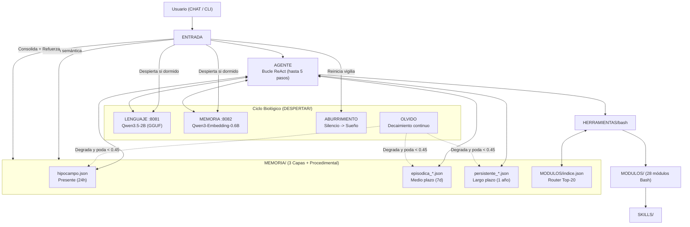

# IAUTONOMA

> **Agente autónomo local construido en 100% Bash puro + `jq` + `llama.cpp`**, con memoria biológica de 3 capas, olvido continuo en tiempo real, ciclo de sueño/vigilia y enrutador vectorial de herramientas.


---

## Filosofía del proyecto

**IAUTONOMA** parte de un principio de diseño estricto:

> **El modelo debe ser libre; el código actúa como soporte biológico, nunca como manipulador.**

* **Sin frameworks pesados** (sin Python, LangChain, bases de datos externas ni contenedores): todo el motor cognitivo corre sobre scripts `#!/bin/bash` y `jq`.
* **Sin condicionales `if` hardcodeados** sobre palabras del usuario para forzar respuestas o herramientas: el recuerdo, el enrutado de módulos y la inhibición por error operan mediante **similitud vectorial** (`Qwen3-Embedding-0.6B`).
* **Autonomía y eficiencia de recursos:** el sistema despierta automáticamente bajo demanda, percibe el silencio, se duerme al expirar el tiempo de vigilia configurado y mantiene el proceso de olvido corriendo de forma independiente sin consumir GPU.

---

## Arquitectura general



---

## Sistema de memoria biológica

Cada interacción se vectoriza (`1024` dimensiones) con fecha y hora exacta (`YYYY-MM-DD HH:MM:SS`) y peso inicial `0.85` (`PESO_INICIAL`). La fuerza de cada recuerdo es la **norma L2 de su vector**.

| Capa | Archivos | Capacidad / Límite | Decaimiento | Función |
| :--- | :--- | :--- | :--- | :--- |
| **Hipocampo** | `MEMORIA/hipocampo.json` | Últimos `6` turnos vivos | `24h` | Mantiene el hilo del momento presente y ancla frases cortas (`< 25` caracteres). |
| **Episódica** | `episodica_*.json` + `indice_episodica.json` | Particiones temáticas (`100` líneas/cajón) | `7 días` (`24*7`) | Recuerdos recientes organizados por centroides normalizados (búsqueda Top-2). |
| **Persistente** | `persistente_*.json` + `indice_persistente.json` | Particiones temáticas (`100` líneas/cajón) | `1 año` (`24*365`) | Neocorteza: recuerdos repetidos o consultados con frecuencia que alcanzan norma `>= 0.99`. |
| **Procedimental** | `MEMORIA/MODULOS/` | Top-`20` módulos por consulta | No decae | Índice vectorial con huella `cksum` para escalar a cientos de módulos sin saturar el prompt. |

### Dinámicas de aprendizaje y olvido
* **Consolidación sin duplicados (`>= 0.80`):** si entra un recuerdo muy similar a otro del mismo cajón, lo fusiona actualizando su fecha y refuerza su norma (`× 1.10`, tope `1.0`).
* **Ascenso automático (`>= 0.99`):** cuando un recuerdo de `episodica` alcanza `0.99` (por repetición en `ENTRADA` o por rescate en `AGENTE`), asciende automáticamente a `persistente`.
* **Inhibición natural por castigo (`DECAIMIENTO_CASTIGO`):** si la entrada del usuario coincide vectorialmente (`>= 0.58`) con `CONCEPTO_CASTIGO`, no elimina el recuerdo de forma brusca: rebaja el último turno del hipocampo y sus equivalentes en episódica/persistente a la norma exacta equivalente a **`1 hora` de vida restante** antes de caer bajo `0.45`.
* **Olvido continuo (`DESPERTAR/OLVIDO`):** corre de forma independiente (incluso con los servidores LLM apagados), multiplica los vectores cada segundo por su factor exponencial, elimina cajones vacíos de sus índices y ofrece un visor en tiempo real.

---

## Ciclo de vigilia, silencio y sueño

Gestionado entre `ENTRADA` y `DESPERTAR/ABURRIMIENTO` según `TIEMPO_DESPIERTO` (`5*60` segundos por defecto):

1. **Despertar automático:** al enviar un mensaje con el sistema dormido, `ENTRADA` arranca `LENGUAJE` (`8081`), `MEMORIA` (`8082`) y `ABURRIMIENTO`, y envía el estímulo interno `<<Te despiertas>>` antes de procesar el turno del usuario.
2. **Percepción de silencio:** al alcanzar la mitad de `TIEMPO_DESPIERTO` sin actividad, `ABURRIMIENTO` envía `--interno "<<Todo esta en silencio>>"` sin reiniciar el temporizador.
3. **Sueño:** al cumplirse `TIEMPO_DESPIERTO`, envía `--interno "<<Te duermes>>"`, verifica que no haya habido una nueva interacción durante ese instante y detiene los procesos en los puertos `8081` y `8082` (manteniendo `OLVIDO` activo).

---

## Bucle agéntico y herramientas

`AGENTE` implementa un bucle `for` de hasta `MAX_REINTENTOS="5"` pasos por turno:
1. Construye el contexto (`hipocampo` + Top-2 recuerdos de `persistente` y `episodica` prefijados con `[YYYY-MM-DD HH:MM:SS]`).
2. `HERRAMIENTAS/bash --spec` selecciona vectorialmente los Top-`20` módulos más relevantes para la consulta y los entrega en el campo `tools`.
3. Si el modelo invoca `bash`, se filtran comandos destructivos, se ejecuta en un subshell aislado (`TIMEOUT_HERRAMIENTA="20"`) cargando `MODULOS/*`, y se devuelve la salida en formato nativo `role: "tool"`.
4. El modelo evalúa el resultado real y decide libremente si ya puede responder (`break`), si reintenta con otro módulo o si encadena un nuevo paso.

---

## Estructura del proyecto

```text
IAUTONOMA/
├── CONFIG                  # Configuración centralizada (modelos, puertos, umbrales, tiempos)
├── CHAT                    # Interfaz interactiva de terminal (historial con flechas, q para salir)
├── ENTRADA                 # Orquestador: despertar, inhibición por castigo, memoria y logs
├── AGENTE                  # Motor LLM + recuperación vectorial + bucle de reintentos (ReAct)
├── DESPERTAR/
│   ├── LENGUAJE            # Servidor llama-server para chat (:8081)
│   ├── MEMORIA             # Servidor llama-server para embeddings (:8082)
│   ├── OLVIDO              # Demonio de decaimiento continuo + visor en tiempo real
│   └── ABURRIMIENTO        # Vigilia automática (silencio -> sueño -> apagado :8081/:8082)
├── HERRAMIENTAS/
│   └── bash                # Router vectorial de módulos (--spec) y ejecutor seguro en jq puro
├── MODULOS/                # 28 módulos Bash cargados dinámicamente
├── SKILLS/
│   └── tareas_bash.txt     # Guías bajo demanda consultables mediante el módulo skill
├── MEMORIA/                # (Ignorado en Git) Capas JSON, índices y caché vectorial
└── REGISTROS/              # (Ignorado en Git) historial.log, server.log y estado de vigilia
```

---

## Requisitos e inicio rápido

### Requisitos
* **Entorno:** Bash (`>= 4`, Linux / Termux / Windows con Git Bash o MSYS2).
* **Utilidades CLI:** `jq`, `curl`, `awk`, `sed`, `grep`, `timeout`, `setsid`, `git`.
* **Motor local:** [`llama-server`](https://github.com/ggml-org/llama.cpp) disponible en el `PATH`.
* **Modelos GGUF** en `../MODELO/` (configurables en `CONFIG`):
  * Lenguaje por defecto: `Qwen3.5-2B-Q4_K_M.gguf` *(compatible también con `4B`, `1.7B`, `0.8B` y `0.6B`)*.
  * Embeddings: `Qwen3-Embedding-0.6B-Q8_0.gguf`.

### Uso básico

```bash
# 1. Chat interactivo (despierta LENGUAJE, MEMORIA y ABURRIMIENTO automáticamente al primer mensaje)
./CHAT

# 2. Consulta directa desde terminal o scripts
./ENTRADA "Tu pregunta aqui"

# 3. Visor y decaimiento continuo de memoria (terminal aparte, opcional)
./DESPERTAR/OLVIDO
```

> [!WARNING]
> No ejecutes `AGENTE`, `HERRAMIENTAS/` ni `MODULOS/` de forma aislada. Utiliza siempre `./CHAT` o `./ENTRADA` para que se gestionen correctamente el despertar automático, la consolidación, la inhibición por castigo y los registros.

---

## Módulos incluidos (`MODULOS/`)

| Categoría | Módulos |
| :--- | :--- |
| **Sistema y archivos** | `ruta`, `listar`, `identificar`, `mirar`, `crear_directorio` (`crear_dir`), `crear_fichero`, `escribir`, `anadir`, `editar`, `copiar_fichero`, `copiar_directorio`, `pegar_fichero`, `pegar_directorio`, `mover`, `renombrar`, `buscar`, `buscar_texto` |
| **Entorno y tiempo** | `fecha`, `hora`, `maquina` |
| **Red y proyectos** | `buscar_internet`, `subir_github` |
| **Meteorología** | `meteo_ahora`, `meteo_hoy`, `meteo_manana`, `meteo_ayer`, `meteo_semana`, `meteo_estacion` |
| **Guías** | `skill` *(sin argumento lista el contenido de `SKILLS/`)* |

---

## Diagnóstico técnico: Patologías observadas en modelos compactos (`2B Q4`)

Parte del desarrollo consiste en documentar el comportamiento real de LLMs compactos (`2B` cuantizados) acoplados a memoria persistente y herramientas. A continuación se resumen las patologías observadas y latentes registradas durante las pruebas:

| Patología | Síntoma | Causa raíz |
| :--- | :--- | :--- |
| **Síndrome del loro / elefante rosa** | Repite literal respuestas pasadas o reproduce un dato erróneo al leer una negación sobre él. | Modelo `2B Q4` + `TEMPERATURA="0.001"` favorece copiar patrones presentes en contexto; las negaciones fijan la atención en el dato mencionado. |
| **Memoria de pez** | Pierde el hilo de recuerdos antiguos o ante consultas ambiguas. | El LLM es *stateless*: si un recuerdo cae bajo `0.45`, sale del límite `MAX_HIPOCAMPO`/`MAX_MEMORIA` o el embedding no alcanza similitud, deja de entrar al prompt. |
| **Loropez (fusión)** | Repite en bucle un fallo reciente de su propio hipocampo. | Retroalimentación entre *pez* y *loro*: `ENTRADA` guarda el error, el modelo lo toma como ejemplo válido y el refuerzo (`>= 0.80`) puede fortalecerlo hasta que actúa `DECAIMIENTO_CASTIGO` u `OLVIDO`. |
| **Fosilización de datos efímeros** | Devuelve una hora, clima o ruta antigua como actual sin llamar a `bash`. | Datos volátiles repetidos superan `0.99`, ascienden a `persistente` (1 año) y el `2B` los confunde con el presente pese a la marca de fecha. |
| **Herramienta fantasma** | Asegura haber ejecutado un módulo o inventa su salida (`/home/usuario`) sin emitir `tool_calls`. | El modelo compacto simula en texto la acción en vez de disparar la llamada estructurada. |
| **Espejo Yo/Tú** | Ante `<<Te duermes>>` o `<<Te despiertas>>` interpreta que quien duerme o despierta es el usuario. | Los estímulos internos entran con `role: "user"` y el modelo interpreta la segunda persona como conversación humana. |
| **Complacencia ciega / Delirio de identidad** | Al corregirlo da la razón a toda costa (llegando a negar su naturaleza de IA). | Alineamiento conversacional (*sycophancy*) que prioriza agradar tras una corrección sobre la coherencia fáctica. |
| **Confusión Módulos vs Skills** | Lista los módulos de `tools` llamándolos *skills* en lugar de ejecutar `bash: skill`. | Interpreta la lista de módulos del esquema `tools` como si ya fuera el contenido de `SKILLS/`. |
| **Bloqueo RLHF de fábrica** | Afirma no tener acceso al sistema operativo ni memoria persistente. | Ante errores o reproches, el reflejo de seguridad del modelo base se impone sobre el `system` prompt. |
| **Tartamudeo XML** | Emite etiquetas rotas (`<tool_call>`, `</parameter>` en bucle) hasta agotar `-n 2048`. | Al intentar invocar una herramienta en texto libre con temperatura `0.001`, el token de cierre se retroalimenta. |
| **Punto ciego del router** *(latente)* | Improvisa con un módulo erróneo si el correcto no entra al prompt. | Con `28` módulos y `MAX_MODULOS="20"`, consultas muy abstractas pueden dejar el módulo adecuado fuera del Top-20. |
| **Castigo ciego / Falso castigo** *(latente)* | Rebaja un recuerdo sano al hablar de errores de código, o no alcanza fallos de hace `> 1` turno. | `DECAIMIENTO_CASTIGO` se activa por similitud (`0.58`) contra `CONCEPTO_CASTIGO` y actúa sobre el último turno del hipocampo. |
| **Aritmética frágil** *(latente)* | Cruza bien recuerdos y herramientas pero falla restas simples de horas o cantidades. | Limitación numérica inherente a un modelo `2B` cuantizado `Q4`. |
