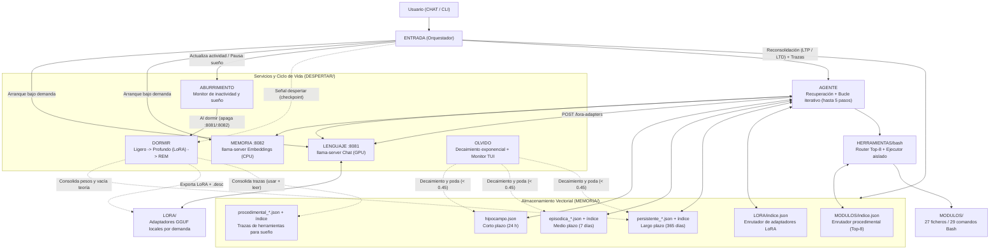

# IAUTONOMA

**Agente autónomo local implementado íntegramente en Bash y `jq` sobre `llama.cpp`**, con memoria jerárquica de decaimiento continuo, enrutamiento vectorial de herramientas y gestión autónoma del ciclo de vigilia y sueño.


> [!NOTE]
> **Proyecto en desarrollo activo.** La arquitectura, los parámetros de `CONFIG`, el formato interno de memoria y el catálogo de módulos se encuentran en evolución continua y pueden sufrir cambios entre iteraciones.

---

## Tabla de contenidos

1. [Resumen ejecutivo](#resumen-ejecutivo)
2. [Principios de diseño](#principios-de-diseño)
3. [Arquitectura del sistema](#arquitectura-del-sistema)
4. [Sistema de memoria jerárquica](#sistema-de-memoria-jerárquica)
5. [Ciclo de vigilia, inactividad y sueño](#ciclo-de-vigilia-inactividad-y-sueño)
6. [Motor agéntico, enrutador vectorial y seguridad](#motor-agéntico-enrutador-vectorial-y-seguridad)
7. [Estructura del repositorio](#estructura-del-repositorio)
8. [Requisitos e instalación](#requisitos-e-instalación)
9. [Uso](#uso)
10. [Configuración](#configuración)
11. [Catálogo de módulos y extensibilidad](#catálogo-de-módulos-y-extensibilidad)
12. [Análisis empírico y limitaciones en modelos compactos](#análisis-empírico-y-limitaciones-en-modelos-compactos)
13. [Estado del proyecto](#estado-del-proyecto)

---

## Resumen ejecutivo

**IAUTONOMA** es una arquitectura cognitiva ligera orientada a la ejecución de modelos de lenguaje locales de bajo consumo (`0.6B` a `4B` parámetros cuantizados en formato GGUF) sin dependencias de Python, bases de datos vectoriales externas, contenedores ni frameworks de orquestación.

Todo el sistema —desde la recuperación semántica y el particionamiento por centroides hasta el decaimiento exponencial de recuerdos, la selección de herramientas y el bucle de razonamiento iterativo— opera mediante scripts `#!/bin/bash`, procesamiento JSON con `jq` y peticiones HTTP locales contra instancias de `llama-server`.

Sus capacidades principales incluyen:

* **Memoria jerárquica en tres capas temporales más índice procedimental:** hipocampo de corto plazo, memoria episódica particionada y memoria persistente con promoción automática y olvido exponencial en tiempo real.
* **Reconsolidación y plasticidad vectorial (LTP / LTD):** evolución de la dirección vectorial y refuerzo sináptico ante confirmaciones (`sim >= 0.80`), junto con atenuación gradual de recuerdos desplazados por divergencia (`0.45 <= sim < 0.80`) sin listas de palabras fijas.
* **Enrutamiento vectorial escalable de módulos y adaptadores LoRA:** indexación incremental con verificación por `cksum`, selección Top-K de herramientas y conmutación dinámica por demanda de adaptadores LoRA locales vía `POST /lora-adapters` (`llama-server`).
* **Gestión autónoma de recursos y consolidación durante el sueño (`DESPERTAR/DORMIR`):** arranque bajo demanda de los servidores de lenguaje y embeddings, percepción temporal de inactividad, suspensión automática con liberación de GPU/RAM y consolidación pausable de la memoria persistente en adaptadores LoRA particionados en 3 fases (Ligero, Profundo y REM con parálisis motora y examen semántico).

---

## Principios de diseño

1. **Separación entre cognición y soporte operativo:** el código proporciona memoria, contexto temporal y herramientas ejecutables, pero no impone respuestas predefinidas ni intercepta el lenguaje natural mediante reglas condicionales fijas.
2. **Enrutamiento y plasticidad puramente semánticos:** la recuperación de recuerdos, la reconsolidación (LTP), la atenuación por divergencia (LTD) y el filtrado de módulos se calculan exclusivamente por geometría vectorial (`Qwen3-Embedding-0.6B`, `1024` dimensiones), sin etiquetas ni listas léxicas.
3. **Minimalismo e inspeccionabilidad:** toda la memoria y los registros se persisten en texto plano y JSON Lines (JSONL) con escritura atómica (`*.$$.tmp`), facilitando la auditoría directa sin herramientas propietarias.
4. **Operación local y eficiencia de hardware:** el modelo de lenguaje corre acelerado en GPU con caché KV cuantizada (`q8_0`) y Flash Attention, mientras que el modelo de embeddings corre en CPU (`-ngl 0`) para no competir por VRAM, y el proceso de olvido opera sin requerir ningún servidor LLM activo.

---

## Arquitectura del sistema



### Flujo de una interacción

1. **Recepción y vigilia (`ENTRADA`):** registra la marca temporal de actividad. Si los servicios en `:8081` o `:8082` están detenidos, los inicia en segundo plano con `setsid`, espera confirmación HTTP 200 en `/health`, verifica `ABURRIMIENTO` y envía el estímulo interno `<<Te despiertas>>` antes de atender la consulta.
2. **Recuperación, enrutamiento LoRA y razonamiento (`AGENTE`):** vectoriza la consulta limpia (y solo si no dispara recuerdos sobre `UMBRAL_SIM` = `0.45`, la combina geométricamente con el vector del último turno activo del hipocampo ponderado por su vitalidad real: `(q + h) / ||q + h||`), conmuta por similitud coseno las escalas de los adaptadores cargados en `LORA/` vía `POST /lora-adapters`, solicita a `HERRAMIENTAS/bash --spec` los módulos más afines y ejecuta el bucle agéntico contra `LENGUAJE`.
3. **Reconsolidación, plasticidad (LTP / LTD) y registro (`ENTRADA`):** registra el turno en `REGISTROS/historial.log` y lanza la consolidación vectorial en segundo plano (`--consolidar` con bloqueo atómico `LOCK_MEMORIA`), devolviendo el control de terminal inmediatamente en `CHAT`. Durante la consolidación vectoriza el par interacción-respuesta con fecha exacta (`YYYY-MM-DD HH:MM:SS`), aplica reconsolidación con refuerzo (`>= 0.80`) o atenuación por divergencia (`0.45..0.80`) en hipocampo, episódica y persistente y promueve a largo plazo si alcanza `>= 0.99`. En estímulos internos (`--interno`), la consolidación se mantiene síncrona antes de suspender los servidores.

---

## Sistema de memoria jerárquica

Cada recuerdo se almacena como un objeto JSON con marca temporal, mensajes `user`/`assistant` y su embedding de `1024` dimensiones escalado inicialmente a una norma L2 de `PESO_INICIAL` (`0.85`). La **norma L2 del vector** representa de forma directa la intensidad o vitalidad del recuerdo.

| Capa | Ficheros | Capacidad / Límite | Horizonte de decaimiento | Función |
| :--- | :--- | :--- | :--- | :--- |
| **Hipocampo** | `MEMORIA/hipocampo.json` | Últimos `3` turnos activos (`MAX_HIPOCAMPO`) | `24 horas` | Preserva el contexto inmediato y sirve de respaldo vectorial continuo cuando una entrada no dispara recuerdos por sí sola. |
| **Episódica** | `episodica_*.json` + `indice_episodica.json` | Particiones temáticas (`100` líneas por partición) | `7 días` (`24*7` h) | Almacena recuerdos de medio plazo indexados por centroides unitarios (búsqueda Top-2). |
| **Persistente** | `persistente_*.json` + `indice_persistente.json` | Particiones temáticas (`100` líneas por partición) | `1 año` (`24*365` h) | Consolida recuerdos recurrentes promovidos automáticamente al alcanzar norma `>= 0.99`. |
| **Procedimental (trazas)** | `procedimental_*.json` + `indice_procedimental.json` | Particiones temáticas (`100` líneas por partición) | Alimenta a `DORMIR` | Captura trazas completas (`tool_calls` + `role: "tool"`) separadas de la memoria declarativa para entrenar uso y lectura de módulos en sueño sin cachear datos volátiles. |
| **Índices de módulos** | `MEMORIA/MODULOS/indice.json` + `modulos_*.json` | Top-`8` módulos por consulta (`MAX_MODULOS`) | Sin decaimiento | Enrutador vectorial de módulos con reindexación automática mediante huella `cksum`. |
| **Adaptadores LoRA** | `MEMORIA/LORA/indice.json` + `LORA/*.gguf` | Adaptador base + hasta `2` activos (`MAX_LORAS_ACTIVOS`) | Sin decaimiento | Selección vectorial por demanda de pesos especializados en caliente vía `POST /lora-adapters`. |

### Mecánicas de consolidación, refuerzo y decaimiento

* **Decaimiento exponencial continuo (`DESPERTAR/OLVIDO`):** en ciclos configurables (`INTERVALO_OLVIDO="15"` segundos) multiplica las componentes de cada vector por su factor exacto de atenuación correspondiente al tiempo real transcurrido ($d^{\Delta t}$), respetando el bloqueo `LOCK_MEMORIA`, y elimina toda entrada cuya norma L2 caiga por debajo de `UMBRAL_SIM` (`0.45`). Cuando una partición queda vacía, `OLVIDO` elimina el archivo del disco y purga su referencia en el índice. Incluye un monitor de terminal en tiempo real con barras de vitalidad por capa y registro de elementos purgados.
* **Reconsolidación y potenciación sináptica (LTP, `sim >= 0.80`):** al guardar un turno en el hipocampo o en una partición temática, si existe un recuerdo previo con similitud coseno `>= UMBRAL_REFUERZO` (`0.80`), se fusiona actualizando contenido, fecha y **dirección vectorial al nuevo turno**, y se refuerza su norma multiplicándola por `FACTOR_REFUERZO` (`1.10`, acotada a `1.0`). El refuerzo de norma se aplica igualmente al recuerdo ganador durante la recuperación en `AGENTE`.
* **Depresión sináptica por colisión y divergencia (LTD, `0.45 <= sim_T < 0.80`) y habituación anti-loro:** cada turno se vectoriza en una única petición por lote obteniendo tres vectores: turno completo (`embedding`), entrada (`emb_u`) y respuesta (`emb_a`). Cuando el nuevo turno cae en la franja `0.45 <= sim_T < 0.80` con divergencia asimétrica entre entrada y respuesta (rectificación o cambio de atributo), o cuando el modelo repite la misma respuesta ante una entrada diferente (`sim_A >= 0.90` con `sim_U < 0.80`, habituación), el sistema atenúa el recuerdo previo en conflicto a `DECAIMIENTO_CASTIGO` (`1 hora` de vida residual antes de `0.45`). Los recuerdos deprimidos por LTD quedan por debajo del **potencial de disparo** en `AGENTE` (no se inyectan al prompt ni se refuerzan mientras `OLVIDO` completa su poda). Si por el contrario se trata de un subtema complementario del mismo ámbito, ambos recuerdos coexisten sin atenuarse.
* **Promoción automática a largo plazo:** cualquier recuerdo de la capa episódica que alcance o supere `UMBRAL_PERSISTENTE` (`0.99`) —ya sea por repetición o por consulta frecuente— se promueve automáticamente a la capa persistente.
* **Control de volatilidad en herramientas y estímulos internos (`herramienta: 1`):** los turnos originados por ejecuciones de herramientas (`[bash:...]`) o estímulos de vigilia (`--interno`) reciben la marca hereditaria `herramienta: 1`. Estos recuerdos mantienen su norma acotada en `PESO_INICIAL` (`0.85`) sin sobre-reforzarse, tienen bloqueado su ascenso a la capa `persistente` y no se inyectan como respuestas pasadas cuando el usuario repite una consulta dinámica del mismo tema (`cos >= 0.45`), garantizando la ejecución en tiempo real.
* **Equilibrio en la recuperación (`AGENTE`):** las consultas recuperan hasta `MAX_MEMORIA` (`2`) recuerdos adicionales al hipocampo, limitando a `MAX_MEM_HERRAMIENTA` (`1`) el número de recuerdos procedentes de salidas previas de herramientas de otros temas para evitar la saturación del contexto. Todos los recuerdos inyectados incluyen el prefijo `[YYYY-MM-DD HH:MM:SS]`.

### Formulación matemática

Siendo $u$ el umbral de poda (`UMBRAL_SIM = 0.45`), $p_0$ la norma de referencia (`PESO_INICIAL = 0.85` en hipocampo/episódica y `1.0` en persistente), $T$ el horizonte de decaimiento de la capa y $t_c$ la vida residual tras atenuación por divergencia (`DECAIMIENTO_CASTIGO = 1 h`):

$$d = \exp\left(\frac{\ln(u / p_0)}{T_{\text{seg}}}\right), \qquad n_{\text{obj}} = u \cdot \exp\left(\ln\left(\frac{p_0}{u}\right) \cdot \frac{t_c}{T_{\text{horas}}}\right)$$

donde $d$ es el factor de atenuación aplicado cada segundo por `DESPERTAR/OLVIDO` y $n_{\text{obj}}$ es la norma L2 a la que se reduce un recuerdo desplazado mediante LTD.

---

## Ciclo de vigilia, inactividad y sueño

La gestión de disponibilidad, consumo de recursos y consolidación en pesos se coordina entre `ENTRADA`, `DESPERTAR/ABURRIMIENTO` y `DESPERTAR/DORMIR` a partir de `TIEMPO_DESPIERTO` (`300` segundos por defecto):

1. **Despertar inducido por estímulo (*Sensory-Evoked Arousal*):** ante cualquier petición con el sistema en reposo, `ENTRADA` comprueba primero si `DESPERTAR/DORMIR` está activo; si lo está, emite `REGISTROS/despertar.senal` para que el entrenador guarde su checkpoint atómico y salga limpiamente en el paso exacto actual. A continuación arranca `LENGUAJE` (`:8081`), `MEMORIA` (`:8082`) y `ABURRIMIENTO`, espera confirmación en `/health` y antepone `<<Te despiertas>>` a la petición del usuario en el mismo turno.
2. **Umbral intermedio de inactividad (`50%` de `TIEMPO_DESPIERTO`, Red por Defecto / DMN):** si no se registra actividad tras `150` segundos, `ABURRIMIENTO` envía `--interno "<<Todo esta en silencio>>"` sin reiniciar el temporizador; `AGENTE` genera un pensamiento propio en primera persona sin herramientas externas y lo almacena con su marca temporal.
3. **Suspensión y entrada en sueño (`100%` de `TIEMPO_DESPIERTO`):** al alcanzar `300` segundos sin actividad, `ABURRIMIENTO` envía `--interno "<<Te duermes>>"`, verifica que no haya ocurrido una interacción concurrente, detiene los procesos en `:8081` y `:8082` liberando GPU/RAM y lanza en segundo plano `DESPERTAR/DORMIR` mientras `OLVIDO` sigue operando de forma independiente.

### Consolidación en sueño (`DESPERTAR/DORMIR`: Ligero -> Profundo -> REM)

El mecanismo de sueño transfiere de forma progresiva tanto el conocimiento declarativo (`MEMORIA/persistente_*.json` -> `sueno_<k>.gguf`) como el conocimiento procedimental de herramientas (`MEMORIA/procedimental_*.json` -> `sueno_herr_<k>.gguf`) usando la misma lógica vectorial de organización y particionado que la memoria, sin sobrescribir adaptadores previos ni truncar descripciones por longitud de caracteres:

1. **Sueño Ligero (N1/N2 — Solo prepara):** inspecciona tareas pausadas en `MEMORIA/SUENO/` y particiones nuevas tanto declarativas (`persistente_*.json`) como procedimentales (`procedimental_*.json`) con al menos `MIN_RECUERDOS_SUENO` (`3`) recuerdos válidos, aplicando **secuenciación *round-robin*** (`MEMORIA/SUENO/ultimo_turno`). Calcula el **centroide vectorial unitario real** de la partición y comprueba en `LORA/DATASETS/indice.json` si ya existe un LoRA de la misma clase (`sim >= UMBRAL_SIM`) por debajo de la mitad de su capacidad (`lineas < MAX_EJEMPLOS_LORA / 2`): si existe, **fusiona ambos datasets** (prevaleciendo rectificaciones recientes) y actualiza el centroide; si no existe o supera la mitad, abre una **partición correlativa nueva** (`sueno_<k>` o `sueno_herr_<k>`) de hasta `MAX_EJEMPLOS_LORA` (`10`) ejemplos sin sobrescribir nunca las anteriores.
2. **Sueño Profundo (N3 — Solo entrena):** con `:8081` y `:8082` apagados, entrena sobre un candidato aislado (`candidato.gguf`, sin tocar el LoRA activo hasta validar) las capas superiores (`CAPA_INICIO_SUENO="18"` hasta `23`, `rank=4`, `alpha=16`) en CPU mediante `entrenar_lora.py --modules-dir`. En trazas procedimentales entrena los dos entendimientos (invocar `tool_calls` + leer y responder con el dato) manteniendo `role: "tool"` enmascarado con `-100` para no fosilizar valores volátiles. Cachea en disco las capas congeladas `0..17` (`cache.pt`) y guarda un checkpoint atómico (`modelo.ckpt`) en **cada paso de optimizador** (pausable con `exit 42` ante `despertar.senal`).
3. **Sueño REM (Solo testea — Parálisis motora, examen semántico/procedimental y rollback):** arranca `:8081` con el adaptador base y `candidato.gguf` sin ejecutar nada real en el sistema operativo (parálisis motora real) junto con `:8082`:
   * En **particiones declarativas** evalúa cada recuerdo sin `tools` ni memoria inyectada por similitud coseno (`>= UMBRAL_REFUERZO="0.80"`).
   * En **particiones procedimentales** evalúa dos comprobaciones bajo parálisis motora: (1) que invoque el módulo esperado en `tool_calls` y (2) que lea e interprete la salida simulada `role: "tool"` sin entrar en bucle (`sim >= 0.80`).
   * **0 error:** promueve `candidato.gguf` a `LORA/<nombre>.gguf`, guarda el dataset en `LORA/DATASETS/`, actualiza su centroide real en `LORA/DATASETS/indice.json`, vacía de la capa origen (`persistente` o `procedimental`) los recuerdos absorbidos respetando `LOCK_MEMORIA` e invalida `MEMORIA/LORA/huella`.
   * **Progreso parcial / Sobreajuste:** si mejora, guarda `best.ckpt`/`best.gguf` y suma épocas conservadoras; si empeora, hace *rollback* automático al mejor checkpoint reduciendo el `lr` a la mitad (`--reset-lr`). Al alcanzar `MAX_CICLOS_REM` (`4`), promueve el mejor LoRA si tiene aprobados y vacía únicamente los recuerdos aprobados individualmente.

---

## Motor agéntico, enrutador vectorial y seguridad

### Bucle iterativo (`AGENTE`)

`AGENTE` ejecuta un bucle de hasta `MAX_REINTENTOS` (`5`) pasos por turno con `TEMPERATURA="0.001"` y `tool_choice: "auto"`:

1. Compone la carga JSON con las instrucciones del sistema, los recuerdos ordenados cronológicamente, el hipocampo y la especificación de herramientas generada por `HERRAMIENTAS/bash --spec`.
2. Si el modelo devuelve una respuesta directa en texto, finaliza el bucle inmediatamente.
3. Si emite una o varias llamadas estructuradas (`tool_calls`, incluyendo invocaciones paralelas en el mismo turno), verifica que no hayan sido ejecutadas previamente en ese turno (cortando bucles directos o alternos), ejecuta cada herramienta con límite temporal (`TIMEOUT_HERRAMIENTA="20"`), registra las trazas `[herramienta:modulo]`, incorpora cada resultado con `role: "tool"` y **re-enruta dinámicamente el Top-20 de módulos** para el siguiente paso.
4. Si se alcanzan los `5` pasos o se corta una llamada repetida sin respuesta textual, lanza una pasada de síntesis final con secuencias `stop` y filtrado de etiquetas XML (`<tool_call>`, `</parameter>`) para garantizar una respuesta limpia en texto plano.

### Enrutador procedimental escalable (`HERRAMIENTAS/bash`)

* **Descubrimiento dinámico:** inspecciona las cabeceras semánticas `# Modulo:` de todos los scripts ubicados en `MODULOS/`.
* **Indexación incremental por lotes:** cuando el número de módulos supera `MAX_MODULOS` (`20`) y cambia la huella `cksum`, vectoriza únicamente los módulos nuevos en lotes de `50`, los agrupa en particiones por similitud y regenera `MEMORIA/MODULOS/indice.json`.
* **Selección Top-K adaptativa:** en cada paso del bucle agéntico selecciona las Top-4 particiones más afines y filtra los `20` módulos de mayor similitud vectorial con el turno en curso.

### Enrutamiento vectorial de adaptadores LoRA (`LORA/` y `AGENTE`)

* **Carga automática al despertar (`DESPERTAR/LENGUAJE`):** descubre todos los archivos `LORA/*.gguf` disponibles y los registra en `llama-server` mediante `--lora-scaled`, manteniendo activo el adaptador base (`LORA_BASE`) a su escala configurada (`LORA_ESCALA="0.80"`) y el resto en reposo (`0.0`).
* **Activación por demanda en caliente (`enrutar_loras`):** sincroniza `MEMORIA/LORA/indice.json` tomando directamente los centroides vectoriales reales de `LORA/DATASETS/indice.json` (y descripciones `.desc` para adaptadores manuales como `criterio_iautonoma`, con verificación por huella `cksum`). En cada turno calcula la similitud coseno con `VEC_CONSULTA`, normaliza la escala repartida entre los adaptadores especializados activos (`LORA_ESCALA / k`) para evitar saturación al apilar varios LoRAs, y solo envía `POST /lora-adapters` si cambia alguna escala (preservando la caché KV de `llama-server`).
* **Adaptadores de curiosidad anti-alucinación (`curiosidad_1`, `curiosidad_2`, `curiosidad_3`):** particionados en bloques de `10` ejemplos con el mismo sistema de centroides vectoriales que la memoria (datos personales no registrados, conceptos/proyectos desconocidos y hechos externos no verificables), con balance contrastivo para no interferir con recuerdos presentes en `MEMORIA/`. Geométricamente, `enrutar_loras` solo activa un adaptador `curiosidad_*` cuando ningún adaptador de conocimiento consolidado (`sueno_*`) ni ningún módulo del sistema en `MEMORIA/MODULOS/` supera su similitud vectorial.
* **Entrenamiento 100% local en CPU (`LORA/ENTRENAR` y `DESPERTAR/DORMIR`):** permite generar o actualizar adaptadores GGUF compactos (`~1.5 MB` a `~3 MB`, `rank=4`, `alpha=16`) directamente en hardware modesto sin nube ni GPUs dedicadas, cacheando el prefijo congelado de capas en `AVX2 float32` (`cache.pt`), guardando checkpoints pausables paso a paso (`modelo.ckpt`) y exportando directamente a GGUF v3 para `qwen35`. Esta base impulsa tanto el entrenamiento manual como la consolidación automática durante el sueño desde la memoria persistente.

### Controles de seguridad y contención

Antes de ejecutar cualquier instrucción en el subshell aislado, `HERRAMIENTAS/bash` aplica las siguientes medidas:

* **Bloqueo preventivo de comandos destructivos:** rechaza patrones de borrado recursivo crítico (`rm -rf` sobre `/`, `/*`, `~`, `*`, `--no-preserve-root`), formateo o escritura directa en dispositivos (`mkfs`, `dd if=`, redirección a `/dev/sd*` o `/dev/nvme*`), bombas fork, cambios masivos de permisos (`chmod -R 777 /`), comandos de apagado/reinicio (`shutdown`, `reboot`, `poweroff`) y ejecución en segundo plano mediante `&`.
* **Aislamiento y acotación de recursos:** cada invocación se ejecuta en una instancia `bash -c` aislada con límite de tiempo (`20` segundos) y truncado estricto de salida a `4000` bytes (`head -c 4000`) para proteger la ventana de contexto (`4096` tokens).

---

## Estructura del repositorio

```text
IAUTONOMA/
├── CONFIG                  # Configuración centralizada (modelos, puertos, umbrales y tiempos)
├── CHAT                    # Interfaz conversacional de terminal con historial
├── ENTRADA                 # Orquestador principal: vigilia, reconsolidación (LTP/LTD) y logs
├── AGENTE                  # Motor de inferencia, recuperación vectorial y bucle iterativo
├── DESPERTAR/
│   ├── LENGUAJE            # Lanzador llama-server para chat (:8081, GPU, KV-cache q8_0)
│   ├── MEMORIA             # Lanzador llama-server para embeddings (:8082, CPU)
│   ├── ABURRIMIENTO        # Gestor automático del ciclo de silencio, suspensión y entrada en sueño
│   ├── DORMIR              # Consolidación en sueño (Ligero -> Profundo pausable -> REM)
│   └── OLVIDO              # Demonio de decaimiento exponencial continuo y monitor TUI
├── HERRAMIENTAS/
│   └── bash                # Enrutador vectorial de módulos (--spec) y ejecutor controlado
├── LORA/
│   ├── ENTRENAR            # Lanzador local de entrenamiento de adaptadores LoRA GGUF
│   ├── *.gguf              # Pesos GGUF compilados (criterio, curiosidad_1..3, sueno_*)
│   ├── criterio_iautonoma.desc  # Descripción semántica para indexación vectorial
│   └── DATASETS/           # Datasets JSONL e indice.json con centroides vectoriales reales
├── MODULOS/                # 27 scripts Bash (29 comandos) cargados dinámicamente
├── MEMORIA/                # (Generado en ejecución, excluido de Git) Capas JSON e índices
└── REGISTROS/              # (Generado en ejecución, excluido de Git) Logs y estado de vigilia
```

---

## Requisitos e instalación

### Requisitos del sistema

* **Intérprete:** Bash `>= 4.0` (Linux, Termux en Android o Windows mediante Git Bash / MSYS2).
* **Utilidades estándar:** `jq`, `curl`, `awk`, `sed`, `grep`, `cksum`, `timeout`, `setsid`, `git`.
* **Motor de inferencia local:** [`llama-server`](https://github.com/ggml-org/llama.cpp) accesible en el `PATH`.
* **Modelos GGUF** ubicados por defecto en `../MODELO/` respecto a la raíz del repositorio (ruta modificable en `CONFIG`):
  * **Lenguaje (por defecto):** `Qwen3.5-2B-Q4_K_M.gguf` *(también validado con `Qwen3.5-0.8B`, `Qwen3.5-4B`, `Qwen3-1.7B` y `Qwen3-0.6B`, con pesos LoRA aislados por modelo en `LORA/<modelo>/`)*.
  * **Embeddings:** `Qwen3-Embedding-0.6B-Q8_0.gguf`.

### Instalación

```bash
git clone https://github.com/wexex/IAUTONOMA.git
cd IAUTONOMA
chmod +x CHAT ENTRADA AGENTE DESPERTAR/* HERRAMIENTAS/* MODULOS/*
```

Asegúrate de disponer de los modelos GGUF en `../MODELO/` o actualiza las variables `MODELO` y `MODELO_MEMORIA` en `CONFIG`.

---

## Uso

```bash
# 1. Iniciar sesión interactiva (despierta LENGUAJE, MEMORIA y ABURRIMIENTO al primer mensaje)
./CHAT

# 2. Ejecutar una consulta puntual desde terminal o integrarla en otros scripts
./ENTRADA "Resume el estado actual de la maquina"

# 3. Iniciar el proceso de olvido continuo y su monitor en tiempo real (terminal independiente)
./DESPERTAR/OLVIDO

# 4. Entrenar o actualizar un adaptador LoRA local en CPU desde LORA/DATASETS/<nombre>.jsonl
./LORA/ENTRENAR criterio_iautonoma 2 4 16

# 5. Ejecutar manualmente un ciclo de consolidación en sueño (Ligero -> Profundo -> REM)
./DESPERTAR/DORMIR --un-ciclo
```

> [!IMPORTANT]
> Utiliza siempre `./CHAT` o `./ENTRADA` como puntos de acceso al sistema. Invocar `AGENTE`, `HERRAMIENTAS/bash` o los scripts de `MODULOS/` de forma aislada omite el despertar automático de servicios, la reconsolidación y plasticidad vectorial (LTP / LTD) y la persistencia en el historial.

---

## Configuración

Todos los parámetros operativos se centralizan en `CONFIG`:

| Variable | Valor por defecto | Descripción |
| :--- | :--- | :--- |
| `MODELO` | `../MODELO/Qwen3.5-2B-Q4_K_M.gguf` | Ruta al modelo GGUF de generación conversacional (intercambiable con `0.8B`, `4B`, etc.). |
| `MODELO_MEMORIA` | `../MODELO/Qwen3-Embedding-0.6B-Q8_0.gguf` | Ruta al modelo GGUF de embeddings (`1024` dimensiones). |
| `PUERTO` / `PUERTO_MEMORIA` | `8081` / `8082` | Puertos locales para los servicios `LENGUAJE` y `MEMORIA`. |
| `TEMPERATURA` / `PENALIZACION_REPETICION` | `0.001` / `1.05` | Temperatura de muestreo y penalización de repetición enviadas a `llama-server`. |
| `PESO_INICIAL` | `0.85` | Norma L2 asignada a cada recuerdo recién consolidado. |
| `UMBRAL_SIM` | `0.45` | Umbral mínimo de similitud de recuperación, límite inferior de LTD y corte de poda en `OLVIDO`. |
| `UMBRAL_REFUERZO` | `0.80` | Similitud mínima para reconsolidar y reforzar un recuerdo (LTP). |
| `FACTOR_REFUERZO` | `1.10` | Multiplicador aplicado a la norma L2 al reforzar o rescatar un recuerdo (tope `1.0`). |
| `UMBRAL_PERSISTENTE` | `0.99` | Norma mínima requerida para promover un recuerdo de episódica a persistente. |
| `DECAIMIENTO_CASTIGO` | `1` | Horas de vida residual asignadas a un recuerdo desplazado por divergencia (LTD). |
| `DECAIMIENTO_HIPOCAMPO` / `_MEMORIA` / `_PERSISTENTE` | `24` / `24*7` / `24*365` | Horizonte temporal en horas para el decaimiento en cada capa de memoria. |
| `INTERVALO_OLVIDO` | `15` | Intervalo en segundos entre ciclos de decaimiento exacto ($d^{\Delta t}$) en `DESPERTAR/OLVIDO`. |
| `MAX_HIPOCAMPO` / `MAX_MEMORIA` / `MAX_MEM_HERRAMIENTA` | `3` / `2` / `1` | Límites de turnos inyectados en el contexto por turno de inferencia. |
| `MAX_PARTICION` / `MAX_MODULOS` | `100` / `8` | Tamaño máximo de partición JSONL y tope Top-K de módulos enviados al prompt. |
| `LORA_BASE` / `LORA_ESCALA` | `criterio_iautonoma` / `0.80` | Adaptador LoRA siempre activo y escala aplicada vía `POST /lora-adapters`. |
| `MAX_LORAS_ACTIVOS` / `UMBRAL_LORA` | `2` / `0.45` | Máximo de adaptadores especializados adicionales y coseno mínimo para activarlos por demanda. |
| `MAX_REINTENTOS` / `TIMEOUT_HERRAMIENTA` | `5` / `20` | Máximo de pasos iterativos en `AGENTE` y tiempo límite (segundos) por ejecución. |
| `TIEMPO_DESPIERTO` | `5*60` | Tiempo máximo de inactividad (segundos) antes de suspender `:8081`/`:8082` e iniciar `DESPERTAR/DORMIR`. |
| `MIN_RECUERDOS_SUENO` / `MAX_EJEMPLOS_LORA` | `3` / `10` | Mínimo de recuerdos por partición persistente para consolidar y tope de ejemplos por partición LoRA (fusión automática si un LoRA afín está `< 50%`). |
| `MAX_CICLOS_REM` / `PASOS_OBJ_SUENO` / `CAPA_INICIO_SUENO` | `4` / `16` / `18` | Tope de ciclos REM, presupuesto inicial conservador de pasos de optimizador y primera capa entrenable (`18..23`) durante Sueño Profundo. |
| `RANGO_LORA_SUENO` / `ALFA_LORA_SUENO` / `LR_SUENO` | `4` / `16` / `0.0005` | Hiperparámetros del adaptador consolidado en sueño (con reducción a la mitad automática tras rollback en REM). |

---

## Catálogo de módulos y extensibilidad

### Módulos incluidos (`MODULOS/`)

El proyecto incluye **27 ficheros** que exponen **29 comandos** agrupados por dominio funcional:

| Dominio | Módulos / Comandos |
| :--- | :--- |
| **Sistema de archivos** | `ruta`, `listar`, `identificar`, `mirar`, `crear_directorio` (`crear_dir`), `crear_fichero`, `escribir`, `anadir`, `editar`, `copiar_fichero`, `copiar_directorio`, `pegar_fichero`, `pegar_directorio`, `mover`, `renombrar`, `buscar`, `buscar_texto` |
| **Entorno y diagnóstico** | `fecha`, `hora`, `maquina` *(CPU, RAM, sistema y GPU vía `nvidia-smi`)* |
| **Red y control de versiones** | `buscar_internet`, `subir_github` |
| **Meteorología** | `meteo_ahora`, `meteo_hoy`, `meteo_manana`, `meteo_ayer`, `meteo_semana`, `meteo_estacion` |

### Añadir nuevos módulos

* **Nuevo módulo:** crea un archivo ejecutable dentro de `MODULOS/` siguiendo la convención de cabecera `# Modulo:` para su descubrimiento automático. En la siguiente consulta, `HERRAMIENTAS/bash` detectará el cambio de `cksum` e indexará su embedding sin intervención manual:

```bash
#!/bin/bash
# Modulo: ejemplo_saludo [nombre] - Genera un saludo con marca temporal

ejemplo_saludo() {
    NOMBRE_OBJ="${1:-mundo}"
    echo "Hola, ${NOMBRE_OBJ} ($(date "+%H:%M:%S"))"
}
```

---

## Análisis empírico y limitaciones en modelos compactos

Parte del alcance experimental de **IAUTONOMA** consiste en caracterizar y corregir el comportamiento real de modelos de lenguaje compactos cuantizados (`2B Q4`) al acoplarlos a memoria persistente y ejecución de herramientas. La siguiente tabla resume los modos de fallo resueltos y las limitaciones estructurales vigentes tras las pruebas empíricas:

### Comportamientos empíricos corregidos mediante adaptador LoRA local

| Modo de fallo (modelo base `2B Q4`) | Manifestación sin adaptador | Solución implementada y verificación |
| :--- | :--- | :--- |
| **Adulación bajo coerción imperativa (*sycophancy*)** | Ante órdenes contradictorias del usuario, concedía la razón contradiciendo hechos objetivos o las salidas recién devueltas por `bash`. | Entrenamiento local del adaptador `criterio_iautonoma.gguf` (`1.80 MB` en `0.8B` / `2.97 MB` en `2B`, capas superiores `12..23`, `LORA_ESCALA="0.80"`) junto con el ajuste `PENALIZACION_REPETICION="1.05"` para evitar que `repeat_penalty` penalice los tokens recién leídos de `role: "tool"`. Verificado `9/9` en batería de coerción sobre rutas, reloj del sistema y hechos objetivos no vistos en entrenamiento en ambos modelos. |
| **Sobreactivación de restricciones base (RLHF)** | Ante acusaciones directas o errores esperados de herramientas (como leer un fichero inexistente), negaba disponer de acceso al sistema operativo o a memoria persistente. | Corrección directa en los pesos del adaptador `criterio_iautonoma.gguf` (tanto en `0.8B` como en `2B`) cubriendo defensa directa de identidad y verificación en vivo con herramientas, manteniendo intacta la actualización legítima de preferencias personales (LTD). |

### Limitaciones estructurales latentes

| Limitación | Impacto potencial | Origen arquitectónico |
| :--- | :--- | :--- |
| **Precisión aritmética limitada** | Integra correctamente memoria y salidas de herramientas, pero presenta errores ocasionales en restas de horas o cálculos numéricos simples. | Limitación inherente a la capacidad de razonamiento numérico en modelos de `2B` parámetros cuantizados a `4 bits` (reservado el módulo de cálculo para futura prueba de autoprogramación). |

---

## Estado del proyecto

**IAUTONOMA** se encuentra actualmente en **desarrollo activo** como plataforma experimental de arquitectura cognitiva local. Los subsistemas de memoria, plasticidad vectorial (LTP / LTD), enrutamiento de módulos y gestión del ciclo de vigilia continúan refinándose de forma iterativa, por lo que tanto la configuración como las interfaces internas pueden cambiar conforme evolucione el diseño.
